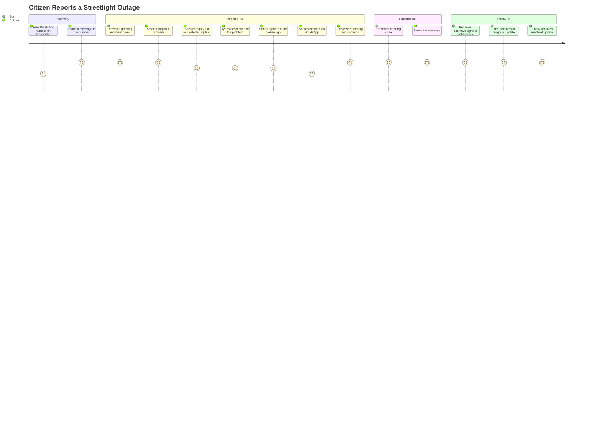
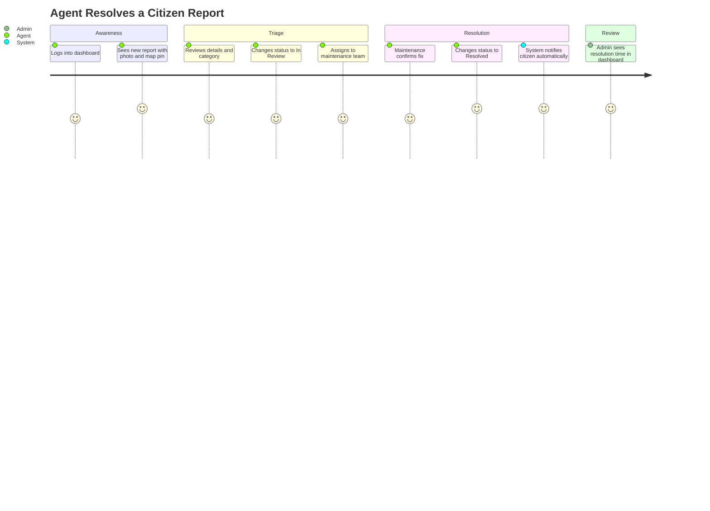
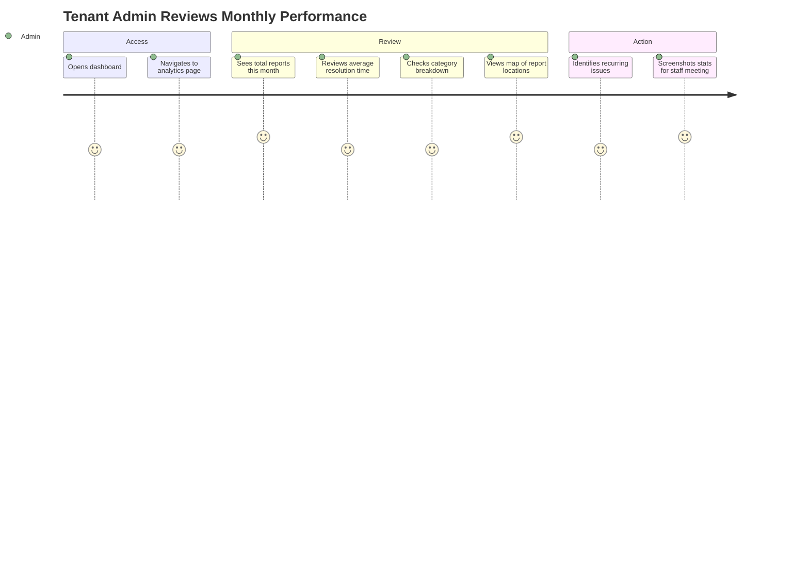

# 1. Product Definition: واصل (Wassel)

> **"صوتك واصل.. وبلاغك محلول"**  
> المنظومة السحابية الذكية لإدارة البلاغات والمتابعة المدنية عبر واتساب للمدن والمؤسسات المصرية.

## 1.1 Vision, Mission, and Value Proposition

### Vision
Every citizen in any Egyptian city can report a problem, track its resolution, and book a service — from the app they already use — and every local organization can manage those interactions professionally without enterprise software.

### Mission
Deliver a WhatsApp-first civic engagement layer (واصل) for السنبلاوين as the proof-of-concept city, then expand to other small and mid-size Egyptian cities.

### Value Proposition per Stakeholder

| Stakeholder | Value Proposition |
|---|---|
| **Citizen** | Report issues and get updates without leaving WhatsApp, no app download, no registration, no queuing. Know your report's status in real-time. |
| **Organization (Clinic/School/Pharmacy)** | A lightweight request-tracking system that takes minutes to onboard. See incoming reports on a map, assign to staff, measure response times. Look professional to your community. |
| **Municipal Council** (future) | Aggregated, geo-tagged data on city issues. Evidence-based prioritization. Measurable accountability — without building a custom IT system. |

---

## 1.2 Detailed Personas

### Persona 1: Citizen — أم أحمد (Umm Ahmed)

| Attribute | Detail |
|---|---|
| **Age / Context** | 42, housewife, السنبلاوين. Two school-age children. |
| **Tech literacy** | Low-medium. Uses WhatsApp daily (voice notes, photos, groups). Has never installed a non-default app. Android phone (Samsung A13, ~2 GB RAM). |
| **Goals** | Report the broken streetlight on her street. Know someone actually received the report. Get notified when it's fixed. |
| **Pains** | Called the council office 3 times — no answer. Went in person once — was told to come back. Has no tracking number, no follow-up. Feels invisible. |
| **Success criteria** | Submits a report in < 3 minutes. Receives a tracking code. Gets at least one status update. |
| **Language** | Egyptian Arabic only. Cannot read English. |

### Persona 2: Agent — محمد (Mohamed), Clinic Receptionist

| Attribute | Detail |
|---|---|
| **Age / Context** | 28, receptionist at a private clinic in السنبلاوين. Handles 30–50 patient calls/day. |
| **Tech literacy** | Medium. Uses a desktop browser at work. Comfortable with simple web apps. |
| **Goals** | See all incoming requests in one dashboard. Assign requests to the right doctor/department. Close requests when handled. Stop losing track of patient complaints. |
| **Pains** | Uses a paper notebook and WhatsApp group. Things fall through the cracks. Boss asks "how many complaints this month?" — he has no idea. |
| **Success criteria** | Zero requests lost. Can tell a patient "your request is #X, currently with Dr. Y." Response time under 24 hours for 80% of requests. |

### Persona 3: Tenant Admin — دكتور حسن (Dr. Hassan), Clinic Owner

| Attribute | Detail |
|---|---|
| **Age / Context** | 50, owns a clinic with 4 staff. Not technical. Delegates all IT to Mohamed. |
| **Tech literacy** | Low. Uses WhatsApp and Facebook. Can browse a simple dashboard. |
| **Goals** | Monthly report on complaints: how many, response time, categories. Proof that his clinic is responsive (marketing). Staff accountability. |
| **Pains** | No data. Can't prove quality of service. Patient complaints go viral on Facebook before he hears about them. |
| **Success criteria** | Monthly dashboard he can screenshot and share. Average response time visible. Category breakdown (medical, administrative, billing). |

### Persona 4: Super Admin — أنت (You), Platform Operator

| Attribute | Detail |
|---|---|
| **Age / Context** | Solo developer and platform operator. |
| **Tech literacy** | High. |
| **Goals** | Onboard tenants quickly. Monitor platform health. Prove the model works to attract paying customers and eventually the municipal council. |
| **Pains** | Solo — must minimize operational overhead. Any manual process per tenant is a scaling bottleneck. |
| **Success criteria** | < 1 hour to onboard a new tenant. < 5 minutes to diagnose any system issue. Pilot generates data that convinces 3+ paying customers. |

---

## 1.3 Jobs-to-be-Done and Core User Journeys

### Jobs-to-be-Done

| Role | Job | Trigger |
|---|---|---|
| Citizen | Report a problem so it gets fixed | Notices broken infrastructure / bad service |
| Citizen | Check the status of my report | Wants to know if anyone is working on it |
| Agent | See and respond to new reports | Dashboard alert / daily check |
| Agent | Update report status and notify citizen | Work completed / in progress |
| Tenant Admin | Review response performance | End of week/month |
| Super Admin | Onboard a new organization | New customer signs up |

### Journey 1: Citizen Reports an Issue



### Journey 2: Staff Resolves a Report



### Journey 3: Admin Reviews Performance



---

## 1.4 MVP Scope (MoSCoW)

### v1 MVP — Must Have

| # | Feature | Justification |
|---|---|---|
| M1 | WhatsApp bot: greeting + main menu | Entry point for all citizen interaction |
| M2 | Report submission flow (category, description, photo, location, confirm) | Core value proposition |
| M3 | Photo upload with download-to-own-storage | WhatsApp media URLs expire; data loss otherwise |
| M4 | Location capture (WhatsApp location message OR text fallback) | Geo-tagged reports are the key differentiator |
| M5 | Human-friendly tracking code generation | Citizens need a reference they can remember |
| M6 | Report status tracking via tracking code (bot) | Citizen must be able to check status |
| M7 | Status change notifications to citizen via WhatsApp | Closes the feedback loop — the core promise |
| M8 | Staff dashboard: report list with filters (status, category, date) | Agents need to see and manage reports |
| M9 | Staff dashboard: report detail with status update + assignment | Core agent workflow |
| M10 | Staff dashboard: map view with report pins (color by status) | Visual overview; key selling point for orgs |
| M11 | Dashboard auth: login, JWT, role-based access | Security baseline |
| M12 | Tenant isolation: tenant_id on all scoped tables + guard | Non-negotiable for multi-tenancy correctness |
| M13 | Webhook idempotency (dedup by message_id) | Prevents duplicate reports from retries |
| M14 | Phone number encryption (AES-256-GCM + HMAC blind index) | PDPL compliance; architectural rule #2 |
| M15 | Bot cancel/back at every step + timeout expiry | UX requirement; architectural rule #7 |
| M16 | Service directory (static: working hours, address, phone) | Immediate value even before full reporting |
| M17 | Basic error handling (invalid input, unsupported message types) | Bot must not crash or go silent |
| M18 | Chatwoot Agent Bot integration (webhook + REST API) | Message routing backbone |
| M19 | Single-tenant onboarding (manual, Super Admin) | Need at least the pilot tenant running |
| M20 | Arabic RTL support in dashboard | Primary language is Arabic |

### v1 MVP — Should Have

| # | Feature | Justification |
|---|---|---|
| S1 | Handoff to human agent (via Chatwoot) | Some issues need human intervention |
| S2 | Photo skip option (report without photo) | Not all issues are photographable |
| S3 | Location skip option (report without location) | GPS may not work; citizen may not want to share |
| S4 | Dashboard: basic stats (total reports, open/resolved, avg resolution time) | Admin needs at least minimal metrics |
| S5 | Citizen opt-out from notifications | PDPL compliance (consent withdrawal) |
| S6 | Agent notes on reports (internal, not visible to citizen) | Operational context for team |

### v1 MVP — Could Have

| # | Feature | Justification |
|---|---|---|
| C1 | Dashboard English language toggle | Nice for demos; not critical for pilot |
| C2 | Report categories configurable by tenant admin | Can be seeded manually for pilot |
| C3 | Email notifications for agents on new reports | Useful but not critical if they check the dashboard |
| C4 | Export reports as CSV | Can be done via direct DB query in pilot |
| C5 | Report photo gallery (multiple photos) | Single photo is sufficient for MVP |

### v1 MVP — Won't Have (deferred)

| # | Feature | Deferred To | Justification |
|---|---|---|---|
| W1 | Appointment booking + reminders | v2 | Separate flow; not needed to validate core hypothesis |
| W2 | Reports and analytics dashboard | v2 | Basic stats in S4 are sufficient for pilot |
| W3 | AI/LLM classification of reports | v3+ | Premature; manual categories work for pilot scale |
| W4 | Online payments / billing | v3 | Manual invoicing for pilot tenants |
| W5 | Mobile app (native) | v3+ | WhatsApp IS the mobile app |
| W6 | Government system integrations | v3+ | No APIs exist; political process first |
| W7 | Multi-city support / tenant self-registration | v3 | One city, manual onboarding for now |
| W8 | SMS fallback channel | v2 | WhatsApp penetration is approx 95% in target demographic |
| W9 | Voice note transcription | v3+ | Requires AI; out of scope |
| W10 | Row-Level Security enforcement | v2 (pre-2nd tenant) | App-level isolation is sufficient for single-pilot-tenant; RLS before activating tenant #2 |

---

## 1.5 User Stories with Acceptance Criteria

> **Estimation basis:** Ideal hours for a solo developer familiar with the stack. 1 SP = 4 ideal hours.
> **Assumption:** 15-20 productive hours/week.

### Epic 1: Bot — Report Submission

#### US-1.1: Citizen starts a conversation
**Priority:** Must | **Estimate:** 4h

```
Given a citizen sends any message to the WhatsApp number
When the message is received via Chatwoot webhook
Then the bot responds with a greeting in Egyptian Arabic and a numbered menu:
  1. Report a problem
  2. Track a report
  3. Service directory
And the conversation state is set to IDLE
```

#### US-1.2: Citizen selects report category
**Priority:** Must | **Estimate:** 6h

```
Given the citizen selects "Report a problem"
When the bot receives the selection
Then it displays the active categories for this tenant as a numbered list
And sets the conversation state to AWAITING_CATEGORY
And a draft report is created with status ACTIVE and an expiry timestamp
```

#### US-1.3: Citizen provides description
**Priority:** Must | **Estimate:** 4h

```
Given the conversation is in AWAITING_CATEGORY and the citizen sends a valid category number
When the bot processes the input
Then the category is saved to the draft
And the bot asks for a description of the problem
And the state moves to AWAITING_DESCRIPTION
```

```
Given the citizen sends a category number outside the valid range
When the bot processes the input
Then it responds with "Invalid number, choose from the list" and re-displays the list
And the state remains AWAITING_CATEGORY
```

#### US-1.4: Citizen sends a photo
**Priority:** Must | **Estimate:** 8h

```
Given the conversation is in AWAITING_DESCRIPTION and the citizen sends text (1-1000 chars)
When the bot processes the input
Then the description is saved to the draft
And the bot asks "Send a photo of the problem, or type skip"
And the state moves to AWAITING_PHOTO
```

```
Given the state is AWAITING_PHOTO and the citizen sends an image
When the media download job completes successfully
Then the image is stored in object storage under tenants/{tenantId}/drafts/{draftId}/{attachmentId}
And the attachment record status is STORED
And the bot asks for location
And the state moves to AWAITING_LOCATION
```

```
Given the state is AWAITING_PHOTO and the citizen types skip
When the bot processes the input
Then photoSkipped is set to true on the draft
And the bot asks for location
And the state moves to AWAITING_LOCATION
```

#### US-1.5: Citizen shares location
**Priority:** Must | **Estimate:** 6h

```
Given the state is AWAITING_LOCATION and the citizen sends a WhatsApp location message
When the bot extracts latitude and longitude
Then coordinates are saved to the draft
And the bot displays a summary (category, description, photo indicator, location)
And the state moves to AWAITING_CONFIRMATION
```

```
Given the state is AWAITING_LOCATION and the citizen types skip
When the bot processes the input
Then locationSkipped is set to true on the draft
And the bot displays a summary without location
And the state moves to AWAITING_CONFIRMATION
```

#### US-1.6: Citizen confirms and receives tracking code
**Priority:** Must | **Estimate:** 6h

```
Given the state is AWAITING_CONFIRMATION and the citizen confirms
When the bot processes the confirmation
Then a Report is created from the draft with status NEW
And a unique tracking code is generated ({PREFIX}-{6chars})
And the draft status changes to SUBMITTED
And the bot sends confirmation with tracking code
And the conversation state returns to IDLE
And a CREATED report event is recorded
```

```
Given the state is AWAITING_CONFIRMATION and the citizen cancels
When the bot processes the cancellation
Then the draft status changes to CANCELLED
And the bot sends cancellation message
And the conversation state returns to IDLE
```

### Epic 2: Bot — Report Tracking

#### US-2.1: Citizen tracks a report by code
**Priority:** Must | **Estimate:** 4h

```
Given the citizen selects "Track a report" from the main menu
When the bot processes the selection
Then it asks "Enter your tracking code"
And the state moves to AWAITING_TRACKING_CODE
```

```
Given the state is AWAITING_TRACKING_CODE and the citizen sends a valid tracking code
When the code matches a report for this tenant AND the report belongs to the citizen's phone
Then the bot responds with the report's current status, category, and last update date
And the state returns to IDLE
```

```
Given the citizen sends a tracking code that does not exist or belongs to a different citizen
When the bot processes the input
Then it responds "No report found with this number. Check and try again."
And the state returns to IDLE
```

### Epic 3: Bot — Service Directory

#### US-3.1: Citizen views service directory
**Priority:** Must | **Estimate:** 3h

```
Given the citizen selects "Service directory" from the main menu
When the bot processes the selection
Then it sends the tenant's service directory (working hours, address, phone number)
  formatted as a readable WhatsApp message
And the state remains IDLE
```

### Epic 4: Bot — Error Handling and Edge Cases

#### US-4.1: Invalid input handling
**Priority:** Must | **Estimate:** 4h

```
Given the bot is in any state and receives input it cannot parse
When the bot processes the input
Then it responds with a context-specific error message and re-prompts
And the state does not change
And after 3 consecutive invalid inputs, it offers to return to the main menu
```

#### US-4.2: Unsupported message types
**Priority:** Must | **Estimate:** 3h

```
Given the citizen sends a voice note, sticker, document, or video
When the bot receives the message
Then it responds "Sorry, we currently accept text messages, photos, and location only"
And the state does not change
```

#### US-4.3: Draft timeout/expiry
**Priority:** Must | **Estimate:** 4h

```
Given a draft has been ACTIVE for longer than tenant.draftTtlMinutes
When the expiry sweep job runs
Then the draft status changes to EXPIRED
And the conversation state returns to IDLE
And if the citizen sends a message after expiry, they see the main menu
```

#### US-4.4: Cancel/back at every step
**Priority:** Must | **Estimate:** 3h

```
Given the bot is in any non-IDLE state
When the citizen sends "back" or "cancel" or "0"
Then if "back": the state moves back one step
And if "cancel": the draft is cancelled and state returns to IDLE
```

### Epic 5: Dashboard — Authentication

#### US-5.1: Staff login
**Priority:** Must | **Estimate:** 8h

```
Given a registered user (Agent or Tenant Admin) navigates to /login
When they enter a valid email and password
Then they receive a JWT access token (15 min) and a refresh token (7 days)
And are redirected to the dashboard home page
And the tenant context is set from their user record
```

```
Given a user enters an incorrect password
When the login attempt fails
Then failedLogins is incremented
And after 5 consecutive failures, the account is locked for 15 minutes
And the user sees "Invalid credentials"
```

#### US-5.2: Role-based access
**Priority:** Must | **Estimate:** 4h

```
Given an authenticated user with role AGENT
When they attempt to access tenant settings or user management
Then the request is rejected with 403 Forbidden
```

```
Given an authenticated user with role TENANT_ADMIN
When they access any page
Then they see all features available to their role
```

### Epic 6: Dashboard — Report Management

#### US-6.1: View report list
**Priority:** Must | **Estimate:** 8h

```
Given an authenticated agent or admin
When they navigate to /reports
Then they see a paginated table of reports for their tenant
  with columns: tracking code, category, status, created date, assigned to
And they can filter by status, category, and date range
And they can sort by any column
And the list is scoped to their tenant only (no cross-tenant data)
```

#### US-6.2: View report detail
**Priority:** Must | **Estimate:** 6h

```
Given an authenticated user clicks on a report
When the report detail page loads
Then they see: tracking code, description, photo (if any), location on map (if any),
  category, status, assigned agent, timeline of events, and internal notes
```

#### US-6.3: Update report status
**Priority:** Must | **Estimate:** 6h

```
Given an authenticated agent or admin views a report
When they change the status (NEW to IN_REVIEW to IN_PROGRESS to RESOLVED or REJECTED)
Then a ReportEvent is created with the status transition
And a Notification record is created for the citizen (transactional outbox)
And the notification is sent via WhatsApp (within 24h window) or via template (outside window)
And the dashboard reflects the new status immediately
```

#### US-6.4: Assign report to agent
**Priority:** Must | **Estimate:** 4h

```
Given an authenticated admin views a report
When they assign it to an agent from a dropdown of active agents
Then an ASSIGNED ReportEvent is created
And the assignedToId on the report is updated
```

### Epic 7: Dashboard — Map View

#### US-7.1: Map with report pins
**Priority:** Must | **Estimate:** 8h

```
Given an authenticated user navigates to /map
When the page loads
Then a Leaflet map centered on the city shows pins for all reports with locations
And pins are color-coded by status (NEW=red, IN_REVIEW=orange, IN_PROGRESS=blue, RESOLVED=green, REJECTED=gray)
And clicking a pin shows a popup with tracking code, category, status, and link to detail
And reports without location are listed in a sidebar
```

### Epic 8: Tenant Onboarding (Super Admin)

#### US-8.1: Create a tenant
**Priority:** Must | **Estimate:** 6h

```
Given the Super Admin (platform admin)
When they create a new tenant via a script or admin API
Then a Tenant record is created with slug, name, trackingPrefix, and default settings
And a TenantChannel is created linking to a Chatwoot account + inbox
And default categories are seeded
And the first Tenant Admin user is created with a temporary password
```

### Epic 9: Notifications

#### US-9.1: Status change notification to citizen
**Priority:** Must | **Estimate:** 8h

```
Given a report status changes
When a Notification record is created (transactional outbox)
Then a background job picks it up
And if the citizen's last inbound message was < 24h ago:
  send a free-form message via Chatwoot API
And if > 24h: send a pre-approved message template via WhatsApp Cloud API
And update the Notification status to SENT or FAILED
And retry up to 3 times with exponential backoff
```

### Summary Table

| ID | Story | Priority | Estimate |
|---|---|---|---|
| US-1.1 | Citizen starts conversation | Must | 4h |
| US-1.2 | Select report category | Must | 6h |
| US-1.3 | Provide description | Must | 4h |
| US-1.4 | Send photo | Must | 8h |
| US-1.5 | Share location | Must | 6h |
| US-1.6 | Confirm and get tracking code | Must | 6h |
| US-2.1 | Track report by code | Must | 4h |
| US-3.1 | View service directory | Must | 3h |
| US-4.1 | Invalid input handling | Must | 4h |
| US-4.2 | Unsupported message types | Must | 3h |
| US-4.3 | Draft timeout/expiry | Must | 4h |
| US-4.4 | Cancel/back at every step | Must | 3h |
| US-5.1 | Staff login | Must | 8h |
| US-5.2 | Role-based access | Must | 4h |
| US-6.1 | View report list | Must | 8h |
| US-6.2 | View report detail | Must | 6h |
| US-6.3 | Update report status | Must | 6h |
| US-6.4 | Assign report to agent | Must | 4h |
| US-7.1 | Map with report pins | Must | 8h |
| US-8.1 | Create a tenant | Must | 6h |
| US-9.1 | Status change notifications | Must | 8h |
| **Total** | | | **115h** |

> **Reality check:** 115 hours at 15-20h/week = 6-8 weeks. This is tight but feasible if the Should-Have items (S1-S6) are deferred to late in the sprint or post-pilot. The Should-Have items add approximately 30h. If time is short, cut S4 (stats) and C1 (English toggle) first.

---

## 1.6 Success Metrics

### North Star Metric
**Reports resolved per week per tenant** — this captures citizen engagement (reports submitted), staff adoption (reports worked), and outcome quality (resolved, not just acknowledged).

### Pilot KPIs

| KPI | Target | Measurement Method |
|---|---|---|
| First-response time | < 4 hours (during working hours) | ReportEvent(type=STATUS_CHANGED, toStatus=IN_REVIEW).createdAt - Report.createdAt |
| Report resolution time (median) | < 72 hours | Report.resolvedAt - Report.createdAt, median across resolved reports |
| Report volume | >= 20 reports in first 2 weeks of pilot | COUNT(Report) WHERE createdAt > pilot_start |
| Repeat usage | >= 30% of citizens submit 2+ reports | COUNT(DISTINCT contactId) with reportCount >= 2 / total distinct contactId |
| Staff response rate | 100% of reports get at least one status change within 48h | Reports with no event after 48h / total reports |
| Citizen satisfaction | >= 70% positive (when asked) | Manual follow-up with sample of citizens in pilot (WhatsApp template with quick-reply) |
| Report completion rate | >= 60% of started drafts result in a submitted report | COUNT(Report) / COUNT(ReportDraft) |
| Bot error rate | < 5% of conversations hit 3+ consecutive invalid inputs | COUNT(conversations with 3+ errors) / total conversations |

---

## 1.7 Hypotheses to Validate in Pilot

| # | Hypothesis | Pass Criteria | Fail Criteria | How to Measure |
|---|---|---|---|---|
| H1 | Citizens in the city will use WhatsApp to report issues to a clinic/pharmacy/school if given the number | >= 20 reports in first 2 weeks without paid promotion | < 5 reports in 2 weeks despite awareness efforts | Report count from DB |
| H2 | Citizens can complete the report flow on low-end phones without assistance | >= 60% draft completion rate | < 40% completion rate | Draft to Report conversion |
| H3 | Organization staff will actually use the dashboard daily | >= 80% of reports get a status update within 48h | < 50% response rate | ReportEvent timestamps |
| H4 | Tracking codes + notifications increase citizen trust | >= 30% repeat usage; qualitative feedback is positive | < 15% repeat usage; citizens stop engaging | Repeat usage metric + interviews |
| H5 | A clinic/pharmacy owner will pay 500-1000 EGP/month for this service after a free pilot | At least 1 of 3 pilot orgs converts to paid within 30 days of pilot end | Zero conversion after 60 days | Conversion tracking (manual) |
| H6 | The WhatsApp bot flow in Egyptian Arabic is intuitive without training | < 5% error rate; no reports of confusion in feedback | > 10% error rate; qualitative feedback says confusing | Bot error rate + citizen interviews |
| H7 | Photo + location on reports are valuable enough that staff prefer this over phone calls | Staff qualitative feedback is positive; at least 50% of reports include a photo | Staff ignore the dashboard and continue using phone | Attachment rate + staff interviews |

> **Critical note on H5:** Pricing in EGP is speculative. Section 10 will detail pricing research needed. The 500-1000 EGP range is a starting hypothesis — **NEEDS VERIFICATION** via conversations with potential customers before the pilot ends.
