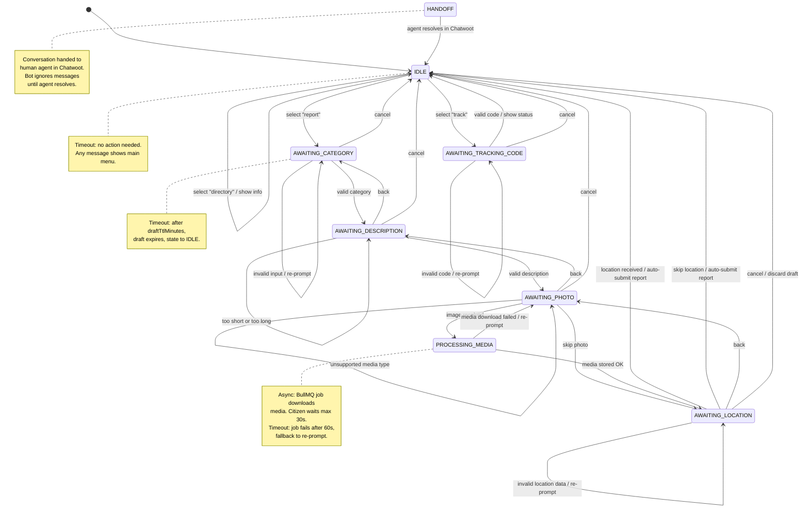
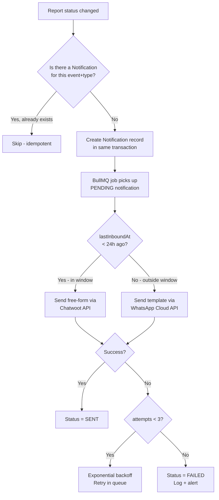

# 2. Conversation and UX Design: واصل (Wassel)

## 2.1 WhatsApp Bot Conversation Design — Full Script (Egyptian Arabic)

> **Convention & Intent Normalization:**
> - **Language:** Egyptian Arabic (عامية مصرية). System text is right-to-left.
> - **Numeral Normalization:** Inputs matching Arabic-Indic digits (`[٠-٩]`) are automatically mapped to Western digits (`[0-9]`).
> - **Fuzzy Intent Matching (عامية مصرية مرنة):**
>   - **Cancel (إلغاء):** Matches `^(إلغاء|الغاء|خلاص|مش عايز|كفاية|الغى|لأ)$/i`.
>   - **Back (رجوع):** Matches `^(رجوع|ارجع|تعديل|الخطوة اللي فاتت)$/i`.
>   - **Skip (تخطي):** Matches `^(تخطي|تخطى|معيش|مفيش|مش معايا|لا يوجد|تجاوز)$/i`.
>   - **Dispute/Reopen (اعتراض):** Matches `^(اعتراض|البلاغ ماتحلش|لسه بايظ|متحلش|مش تمام)$/i`.
>   - **Refresh Window (متابعة):** Matches `^(متابعة|متابعه|تحديث|فين البلاغ)$/i`.

---

### Flow 1: Greeting / Main Menu

**Trigger:** Any incoming message when conversation state is IDLE (including first-ever message).

```
Bot:
أهلاً بيك في منصة واصل 🏙️
خدمة البلاغات والمتابعة لـ [اسم المنظمة]
━━━━━━━━━━━━━━━━━━━━

اختار من القايمة:
1️⃣ بلّغ عن مشكلة
2️⃣ تتبع بلاغ
3️⃣ دليل الخدمات

ابعت رقم الاختيار 👇
```

**Design notes:**
- The organization name is injected from `tenant.name`.
- Using numbered list (not WhatsApp interactive list) for v1 simplicity. Interactive buttons/lists are a Should-Have upgrade (see 2.3).
- Emoji used sparingly for visual anchoring, not decoration.

---

### Flow 2: Submit Report — Category Selection

**Trigger:** User sends "1" in IDLE state.

```
Bot:
🔧 إيه نوع المشكلة؟

1️⃣ إنارة (أعمدة نور)
2️⃣ مياه (انقطاع / تسريب)
3️⃣ صرف صحي
4️⃣ نظافة (قمامة / شوارع)
5️⃣ طرق (حفر / أرصفة)
6️⃣ أخرى

ابعت رقم النوع، أو ابعت "إلغاء" للرجوع ❌
```

**State:** → `AWAITING_CATEGORY`

**Design notes:**
- Categories are loaded from `Category` table (tenant-scoped, ordered by `sortOrder`).
- The menu snapshot is saved in `ReportDraft.stepContext` so "3" means the same thing even if categories change mid-draft.
- Maximum 10 categories displayed (WhatsApp readability limit). If tenant has more, paginate or group.

---

### Flow 3: Submit Report — Description

**Trigger:** Valid category number received in AWAITING_CATEGORY.

```
Bot:
📝 تمام، اختارت: [اسم الفئة]

وصّف المشكلة في رسالة واحدة (مثلاً: "عمود النور اللي قدام مدرسة النور مطفي من أسبوع")

أو ابعت:
↩️ "رجوع" للرجوع للنوع
❌ "إلغاء" لإلغاء البلاغ
```

**State:** → `AWAITING_DESCRIPTION`

**Validation & Human Error Guards:**
- **Text input**: Min 8 meaningful characters (excluding emojis) and at least 2 words.
  - If emoji-only (e.g. `😡`) or single word (e.g. `"الو"`): `"الوصف غير واضح، اكتب تفاصيل أكتر عن المشكلة في جملة مفيدة لمساعدة فريق الصيانة 📝"`
  - If too long: `"الوصف طويل أوي، حاول تختصر في أقل من 1000 حرف ✂️"`
- **Duplicate Ticket Detector (Human Repetition Error)**:
  - If this citizen (`phoneHash`) has an open report in the same category created within the last 2 hours:
    - Bot prompts: *"⚠️ لاحظنا أن عندك بلاغ مسجل بالفعل لنفس المشكلة برقم [SBL-XXXXXX] وحالته: جاري العمل 🔵. اكتب (1) لتأكيد أن ده بلاغ جديد مختلف، أو ابعت تفاصيل إضافية هنضيفها لنفس البلاغ."*
- **Audio Voice Notes (Deferred to v2 for Legal & Scope Optimization)**:
  - In v1, to prevent legal complexity under Egyptian Law 151/2020 (biometric categorization of citizen voice recordings) and eliminate audio transcoding overhead:
  - If a citizen sends a voice note during description:
    - Bot replies politely:
      ```
      Bot:
      🎤 عفواً، المنظومة تستقبل الرسائل المكتوبة فقط في هذه المرحلة.
      
      برجاء كتابة وصف مختصر للمشكلة لمساعدة فريق الصيانة 📝
      ```
    - State remains: `AWAITING_DESCRIPTION`.

---

### Flow 4: Submit Report — Photo

**Trigger:** Valid description received in AWAITING_DESCRIPTION.

```
Bot:
📸 لو عندك صورة للمشكلة ابعتها دلوقتي — الصورة بتساعدنا نفهم المشكلة أسرع

أو ابعت:
⏭️ "تخطي" لو مفيش صورة
↩️ "رجوع" لتعديل الوصف
❌ "إلغاء" لإلغاء البلاغ
```

**State:** → `AWAITING_PHOTO`

**On image received (Accidental Selfie / Photo Safeguard):**
```
Bot:
✅ تم استلام الصورة!
(💡 لو بعت صورة تانية بالخطأ، ابعت كلمة "تعديل" لاختيار صورة تانية 📸)

📍 دلوقتي ابعتلنا الموقع — دوس على 📎 (المرفقات) > 📍 موقع
(لو مش موجود في مكان المشكلة، تقدر تكتب اسم الشارع أو أقرب معلم 📝)

أو ابعت:
⏭️ "تخطي" لو مش عايز تبعت الموقع
↩️ "رجوع" لتعديل الوصف
❌ "إلغاء" لإلغاء البلاغ
```

**On media failure (download/storage failed):**
```
Bot:
⚠️ معرفناش نستلم الصورة. ممكن تبعتها تاني؟

أو ابعت "تخطي" للاستمرار من غير صورة ⏭️
```

**State:** → `AWAITING_LOCATION`

---

### Flow 5: Submit Report — Location & Auto-Submission (Optimized 5-Step Funnel)

**Trigger:** Photo received or skipped in AWAITING_PHOTO.

**State:** → `AWAITING_LOCATION`

**Input Handling:**
1. **On WhatsApp Location Pin Received:**
   - Extracts `latitude` and `longitude`.
   - Auto-submits the report immediately.
2. **On Text Address Received (Smart Address Fallback):**
   - If citizen types a text address instead of a GPS pin (e.g. *"شارع المحطة قدام الجامع الكبير"*):
   - System accepts it without error, stores text directly in `Report.addressText` (max 255 chars, avoiding description overflow), sets `locationSkipped = true`.
   - Auto-submits the report immediately.
3. **On "تخطي" / Skip Intent Received:**
   - Sets `locationSkipped = true`.
   - Auto-submits the report immediately.

**Confirmation & Tracking Response (Direct Auto-Submit):**
```
Bot:
✅ تم استلام الموقع وتسجيل بلاغك بنجاح!

🔖 رقم المتابعة: SBL-K7HN3R
━━━━━━━━━━━━━━━
🔧 النوع: [اسم الفئة]
📝 الوصف: [الوصف...]
📸 الصورة: [✅ مرفقة / ❌ بدون صورة]
📍 الموقع: [✅ محدد على الخريطة / 📝 مسجل بالعنوان / ❌ بدون موقع]
━━━━━━━━━━━━━━━

احتفظ برقم المتابعة ده — تقدر تتابع حالة البلاغ في أي وقت.

💡 لمتابعة البلاغ وتلقي التحديثات مجاناً، تقدر تبعتلنا كلمة "متابعة" بعد يوم لتجديد المحادثة، أو اختار (2) من القائمة الرئيسية ✉️
```

**State:** → `IDLE` (Eliminates the redundant confirmation prompt and streamlines citizen funnel).

---

### Flow 6: Citizen Dispute & Reopening (Within 48h of Resolution)

**Trigger:** Citizen replies `"اعتراض"` or `"البلاغ ماتحلش"` to a `RESOLVED` report notification within 48 hours.

**Validation & Action:**
- Queries the latest resolved report tied to this citizen's `contactId`.
- If `resolvedAt` is within the last 48 hours:
  - System transitions `Report.status` back to `IN_PROGRESS`.
  - Increments `Report.version`.
  - Creates a `ReportEvent` of type `STATUS_CHANGED` with `actorType = CITIZEN` and note: `"تم إعادة فتح البلاغ بواسطة المواطن (اعتراض على الحل)"`.
  - Bot replies:
    ```
    Bot:
    ⚠️ تم إعادة فتح بلاغك رقم [SBL-XXXXXX] وتحويله لفريق المتابعة لفحص الشكوى مرة تانية.
    هنبلغك بأي مستجدات في أسرع وقت 🤝
    ```
- If > 48 hours have elapsed:
  - Bot prompts: *"مر أكتر من ٤٨ ساعة على حل البلاغ السابق. تقدر تسجل بلاغ جديد باختيار (1) من القائمة الرئيسية."*

---

### Flow 7: Track Report

**Trigger:** User sends "2" in IDLE state.

**Logic (Smart Lookup for Citizen Active Reports):**
1. System queries active reports (`status IN ('NEW', 'IN_REVIEW', 'IN_PROGRESS')`) belonging to this citizen's `contactId`.
2. **If citizen has exactly 1 active report**: Bot skips asking for code and displays the active report status card immediately!
3. **If citizen has 0 or multiple active reports**: Bot prompts for the tracking code:

```
Bot:
🔍 اكتب رقم المتابعة بتاعك
(مثال: SBL-K7HN3R)

أو ابعت "إلغاء" للرجوع للقايمة ❌
```

**State:** → `AWAITING_TRACKING_CODE` (only if code is needed; otherwise returns to `IDLE` after showing status)

**Fuzzy Tracking Code Normalization (Typo Tolerance Guard):**
When the citizen submits a tracking code in `AWAITING_TRACKING_CODE`:
1. Strips all leading/trailing whitespace, dashes, and slashes (`SBL - K7HN3R` -> `SBLK7HN3R`).
2. Normalizes Arabic-Indic numerals (`[٠-٩]` -> `[0-9]`).
3. Converts letters to uppercase (`sbl-k7hn3r` -> `SBL-K7HN3R`).
4. Handles common visual OCR/keyboard confusions: maps letter `O` to `0`, letter `I`/`l` to `1`.
5. Automatically formats into the canonical `XXX-XXXXXX` structure before querying the database.

**On valid code (belongs to this citizen):**
```
Bot:
📋 حالة البلاغ: SBL-K7HN3R
━━━━━━━━━━━━━━━
🔧 النوع: إنارة
📊 الحالة: جاري العمل 🔵
📅 تاريخ البلاغ: ١٠ أكتوبر ٢٠٢٦
📅 آخر تحديث: ١١ أكتوبر ٢٠٢٦

💬 آخر تعليق: "تم إرسال فريق الصيانة"
━━━━━━━━━━━━━━━

اختار من القايمة الرئيسية:
1️⃣ بلّغ عن مشكلة
2️⃣ تتبع بلاغ
3️⃣ دليل الخدمات
```

**On invalid code or code belonging to another citizen:**
```
Bot:
❌ مش لاقيين بلاغ بالرقم ده
(💡 تأكد إنك كاتب الكود المكون من ٩ خانات زي ما وصلك في رسالة التأكيد، مثلاً: SBL-K7HN3R)

حاول تاني، أو ابعت "إلغاء" للرجوع للقايمة الرئيسية ❌
```
*(Do not leak existence of another citizen's report).*

---

### Flow 8: Service Directory

**Trigger:** User sends "3" in IDLE state.

```
Bot:
📋 دليل خدمات [اسم المنظمة]
━━━━━━━━━━━━━━━
🕐 مواعيد العمل:
السبت - الخميس: ٩ ص - ٥ م
الجمعة: إجازة

📍 العنوان: [عنوان المنظمة]

📞 تليفون: [رقم التليفون]

🌐 المزيد: [رابط لو موجود]
━━━━━━━━━━━━━━━

اختار من القايمة الرئيسية:
1️⃣ بلّغ عن مشكلة
2️⃣ تتبع بلاغ
3️⃣ دليل الخدمات
```

**Data source:** `tenant.settings.directory` (JSON).

---

### Flow 9: Error Handling

#### Invalid menu selection (IDLE)
```
Bot:
🤔 مش فاهم الاختيار ده. ابعت رقم من القايمة:
1️⃣ بلّغ عن مشكلة
2️⃣ تتبع بلاغ
3️⃣ دليل الخدمات
```

#### Consecutive errors (any state, 3rd invalid input)
```
Bot:
😅 يبدو إن فيه مشكلة. عايز ترجع للقايمة الرئيسية؟
ابعت "قايمة" أو "0" للرجوع
```

#### Voice/Video Call Attempt Auto-Reply (Human Error: Calling WhatsApp Bot)
When a citizen attempts to place a voice or video call to the WhatsApp bot number, the Meta Cloud API automatically rejects/drops the call and triggers a webhook event. The bot immediately fires this friendly guidance message:
```
Bot:
📞 عذراً، هذا الرقم مخصص للرسائل الآلية وتلقي البلاغات فقط، ولا يستقبل مكالمات صوتية أو فيديو.

تقدر تبعت تفاصيل مشكلتك في رسالة مكتوبة 📝 أو رسالة صوتية (Voice Note) 🎤 وهنبدأ في متابعتها فوراً!
```

#### Multi-Photo Burst Handling (Human Error: Rapid Multiple Uploads)
When a citizen sends 3 to 10 photos in rapid succession during `AWAITING_PHOTO`:
- The 1500ms BullMQ debounce lock batches the incoming messages.
- The system persists up to 3 photos as attachments for the draft report.
- Any overflow photos (> 3) are safely ignored without throwing an error.
- The bot replies:
```
Bot:
📸 تم استلام صور المشكلة بنجاح (حفظنا أول ٣ صور لتوضيح البلاغ)!

📍 دلوقتي ابعتلنا الموقع — دوس على 📎 (المرفقات) > 📍 موقع
(أو اكتب اسم الشارع وأقرب علامة مميزة) 📝
```

#### Voice Note Received in Numeric Menu (Human Error: Speaking Instead of Typing Number)
If an elderly citizen (Persona Umm Ahmed) sends a voice note during `AWAITING_CATEGORY` or Main Menu:
```
Bot:
🎤 سمعنا تسجيلك الصوتي، بس في الخطوة دي محتاجين تختار رقم القسم من القائمة (مثلاً: 1 أو 2 أو 3) 🔢

💡 لو حابب تشرح المشكلة بصوتك، هتقدر تسجل فويس نوت في الخطوة اللي جاية على طول بعد اختيار الرقم!
```

#### System error (unexpected failure)
```
Bot:
⚠️ حصل خطأ عندنا. حاول تاني بعد شوية.
لو المشكلة استمرت، تواصل معانا على [رقم الطوارئ]
```

---

## 2.2 Bot State Machine



### Timeout Behavior

| State | Timeout | Action |
|---|---|---|
| IDLE | None | Main menu on any message |
| AWAITING_CATEGORY through AWAITING_CONFIRMATION | `tenant.draftTtlMinutes` (default 30 min) | Draft status → EXPIRED, state → IDLE. Next message shows: "البلاغ اللي كنت بتعمله انتهى وقته ⏰ تقدر تبدأ من جديد" then main menu |
| PROCESSING_MEDIA | 60 seconds (job timeout) | Attachment status → FAILED, re-prompt for photo |
| AWAITING_TRACKING_CODE | `draftTtlMinutes` | State → IDLE |
| HANDOFF | None (controlled by Chatwoot) | When agent resolves/closes conversation in Chatwoot, a webhook fires and state → IDLE |

### Duplicate Message Handling

```
1. Webhook received with message_id
2. Check InboxMessage for (tenantId, provider, providerMessageId)
3. If exists AND status = PROCESSED → ignore silently (return 200)
4. If exists AND status = RECEIVED → already queued, skip enqueue (return 200)
5. If not exists → insert InboxMessage, enqueue for processing
```

### Unsupported Message Types

| Type | Response |
|---|---|
| Voice note | "معلش، مش بنقبل رسائل صوتية حاليًا 🎤 ابعت رسالة نصية" |
| Video | "معلش، مش بنقبل فيديوهات حاليًا 🎥 ابعت صورة لو حابب" |
| Document | "معلش، مش بنقبل ملفات حاليًا 📄 ابعت رسالة نصية أو صورة" |
| Sticker | "😄 ابعتلنا رسالة نصية أو صورة وهنساعدك" |
| Contact card | Same as document |
| Live location | "ابعتلنا موقع ثابت مش مباشر — دوس 📎 > 📍 موقع" |

---

## 2.3 WhatsApp-Specific Constraints and Design Decisions

### 24-Hour Customer Service Window

| Constraint | How We Handle It |
|---|---|
| Free-form messages can only be sent within 24h of the customer's last inbound message | Track `Conversation.lastInboundAt`. Notification sender checks this before choosing message type. |
| Outside the window, only pre-approved **message templates** can be sent | Status update notifications outside the window use templates (see 2.4). |
| Each template message opens a new 24h window ("marketing" category: 72h, but we use "utility") | We use the "utility" category for status updates. **NEEDS VERIFICATION**: current pricing and window rules for utility templates, check [Meta Business Help Center](https://developers.facebook.com/docs/whatsapp/pricing). |

### Interactive Messages (Buttons/Lists)

| Constraint | Decision |
|---|---|
| Quick Reply buttons: max 3 buttons, 20 chars each | **v1:** Use plain numbered text menus instead. Buttons are a v2 upgrade because: (a) simpler to implement, (b) numbered text works on all devices including KaiOS. |
| List messages: max 10 items, 24 chars per row title | Could use for category selection in v2. |
| Interactive messages cannot be sent as templates | Reinforces the decision to use plain text for the bot. |

> **NEEDS VERIFICATION**: Whether Chatwoot's Agent Bot API supports sending interactive message types (buttons/lists) through its REST API. Check Chatwoot docs for `content_type` parameter in message creation.

### Location Messages

| Constraint | Decision |
|---|---|
| WhatsApp location messages contain lat, lng, name, address | Extract lat/lng from the Chatwoot webhook payload. Name/address are user-facing labels, not reliable for geocoding. |
| "Live location" is different from a static location pin | Detect live location (if distinguishable in payload) and ask for a static pin instead. **NEEDS VERIFICATION**: whether Chatwoot distinguishes live vs. static location in its webhook payload. |

### Media Handling

| Constraint | Decision |
|---|---|
| WhatsApp media URLs expire after ~5 minutes | Download immediately upon receiving the webhook. BullMQ job with priority. |
| Max image size: 5 MB (JPEG), 16 MB (PNG) | Accept up to 5 MB. Compress to JPEG if > 2 MB (server-side, using sharp). |
| Supported image types: JPEG, PNG | Validate MIME type from bytes (magic number), not from the Content-Type header. |

### Message Limits

| Limit | Value | Mitigation |
|---|---|---|
| Text message length | 4096 chars | Our longest message (report summary) is ~500 chars. Safe. |
| Messages per second (Cloud API) | 80 msgs/sec (Tier 1) to 1000 msgs/sec (Tier 4) | Irrelevant at pilot scale. Rate limiter in notification sender for safety. |
| Phone number quality rating | Affects sending limits | Monitor in Meta Business Manager. Avoid spammy templates. |

---

## 2.4 Notification Strategy

### Within the 24h Window

When `Conversation.lastInboundAt` is less than 24 hours ago, send a free-form message through the Chatwoot REST API (create message on the conversation).

**Status update (in-window):**
```
تحديث على بلاغك 🔖 {trackingCode}

📊 الحالة الجديدة: {statusArabic} {statusEmoji}
💬 {citizenMessage if present}

ابعت رقم المتابعة في أي وقت لمتابعة التفاصيل
```

### Outside the 24h Window (Message Templates)

Templates must be submitted to Meta for approval. Approval takes 1-24 hours typically.

**Templates to submit:**

| Template Name | Category | Language | Content | Variables |
|---|---|---|---|---|
| `report_status_update` | UTILITY | ar | `تحديث على بلاغك رقم {{1}} - الحالة: {{2}}. لمزيد من التفاصيل تواصل معانا.` | 1: trackingCode, 2: statusArabic |
| `report_confirmation` | UTILITY | ar | `تم تسجيل بلاغك بنجاح. رقم المتابعة: {{1}}. احتفظ بالرقم ده لمتابعة حالة البلاغ.` | 1: trackingCode |
| `report_resolved` | UTILITY | ar | `بلاغك رقم {{1}} تم حله. شكرًا لتواصلك معانا.` | 1: trackingCode |

> **NEEDS VERIFICATION**: 
> - Template submission process via WhatsApp Business Manager or API.
> - Approval time for Egyptian Arabic templates.
> - Whether templates can include emoji.
> - Current per-template message pricing for the "utility" category in Egypt.

### Notification Decision Flow



---

## 2.5 Tone-of-Voice Guidelines

### Principles

| Principle | Guideline | Example |
|---|---|---|
| **Respectful** | Use "حضرتك" sparingly (formal contexts). Default to neutral-polite "أنت" form. | Not: "يا يوزر" |
| **Egyptian colloquial** | Write in عامية مصرية, not فصحى. Use the words people actually say. | "ابعت" not "أرسل", "دلوقتي" not "الآن" |
| **Concise** | Keep messages short. Citizens are on mobile with small screens. | Max 3-4 lines per message where possible |
| **Reassuring** | Always confirm what was received. Never leave the citizen in silence. | "تم استلام الصورة ✅" |
| **Actionable** | Every message ends with what the citizen should do next. | "ابعت رقم الاختيار 👇" |
| **No jargon** | No technical terms. No English loanwords that aren't already common. | "رقم المتابعة" not "tracking ID" |

### Emoji Usage Rules
- Use emoji as visual anchors (e.g., 📸 before photo-related instructions).
- Maximum 2-3 emoji per message.
- Never use emoji to replace text.
- Use standard emoji (no custom stickers, no brand emoji).
- Status emoji are fixed (see status mapping table above).

### Abuse and Spam Handling

| Scenario | Detection | Response |
|---|---|---|
| **High-frequency messages** (> 10 msgs/min from one number) | Rate limiter per `Contact.phoneHash` in Redis | Silently drop messages after limit. Log. Resume after cooldown (1 min). |
| **Profanity / offensive content** | v1: no detection. v2: keyword filter. | Not blocked in v1. Staff see it in dashboard. Tenant admin can flag. |
| **Report spam** (same citizen, many similar reports in short time) | Rate limit: max 5 reports per contact per day (configurable per tenant) | "وصلت الحد الأقصى للبلاغات النهارده. حاول تاني بكرة 📋" |
| **Unsolicited marketing / business messages from the bot** | Never. Bot only responds to citizen-initiated messages or sends status updates for existing reports. | N/A |
| **Citizen sends personal data unsolicited** (e.g., national ID) | v1: no detection. | Data is encrypted in transit and at rest. InboxMessage retention policy applies. Staff guidance in onboarding. |
| **Blocked by citizen** | WhatsApp Cloud API returns error 131031 | Mark notification as FAILED_POLICY. Do not retry. |

### Consent Text

On first interaction (when a new Contact is created), the greeting includes an implicit consent notice:

```
بمجرد تقديم بلاغ، أنت موافق إننا نحتفظ ببياناتك (رقم الموبايل، الوصف، الصور، الموقع) لغرض متابعة البلاغ.
تقدر تطلب حذف بياناتك في أي وقت بإرسال "حذف بياناتي".
```

> This is appended once (first conversation only, tracked by Contact record existence). It satisfies PDPL Art. 2 (consent) and Art. 4 (right to erasure). **NEEDS VERIFICATION**: whether this form of consent (implicit by continued use) is sufficient under Law 151/2020 or if explicit opt-in is required. Consult a lawyer before pilot launch.

---

## Section 2 — Open Issues / Needs Verification

| # | Item | Source to Check |
|---|---|---|
| NV-1 | WhatsApp utility template pricing in Egypt (per-conversation fee) | [Meta WhatsApp Pricing](https://developers.facebook.com/docs/whatsapp/pricing) |
| NV-2 | Whether Chatwoot Agent Bot API supports sending interactive messages (buttons/lists) | [Chatwoot API Docs](https://www.chatwoot.com/docs/product/channels/api/send-messages) |
| NV-3 | Whether Chatwoot webhook distinguishes live location vs. static location | Chatwoot webhook payload documentation + testing |
| NV-4 | Template approval time for Egyptian Arabic | Meta Business Manager — submit and observe |
| NV-5 | Whether emoji are allowed in WhatsApp message templates | [Meta Message Template Guidelines](https://developers.facebook.com/docs/whatsapp/message-templates/guidelines) |
| NV-6 | Whether implicit consent (continued use) satisfies PDPL Law 151/2020 Art. 2 | Egyptian legal counsel |
| NV-7 | WhatsApp 24h window rules: does a utility template reply open a new window? | [Meta Conversation-Based Pricing docs](https://developers.facebook.com/docs/whatsapp/pricing) |
