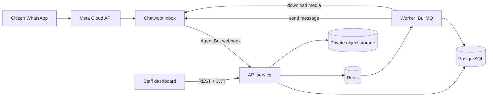

# 3. Technical Architecture

> This section was authored externally and imported. It builds on Part 1 assumptions: one developer, one VPS, open-source-first tooling, the official WhatsApp Cloud API, and no paid AI services.

## 3.1 Architecture Overview

The principle is **a modular monolith with one worker process**, not microservices. A solo developer with 120-160 hours cannot afford service-to-service plumbing.

| Component | Responsibility | Notes |
|---|---|---|
| **Chatwoot** | WhatsApp channel gateway, conversation inbox, human handoff | Self-hosted. It is **not** the system of record for reports. |
| **API service** | Webhook receiver, bot state machine, REST API, auth | One TypeScript process (NestJS). |
| **Worker** | Media download, outbound notifications, retries, expiry sweeps | Same codebase, different entrypoint. |
| **PostgreSQL** | System of record: tenants, reports, events, drafts, inbox, outbox, audit | Separate logical databases for the app and Chatwoot. |
| **Redis** | Queues, locks, rate limits, short-lived conversation state | Persistence on (AOF). Never the only copy of a draft or report. |
| **Object storage** | Report photos | MinIO or any S3-compatible store, private bucket, signed URLs only. |
| **Reverse proxy** | TLS, routing, basic request limits | Caddy for automatic certificates. |

**Key boundary:** Chatwoot owns *conversations*. Your database owns *reports*. If Chatwoot is down, staff can still see and update reports in the dashboard, though citizens can't be reached until it returns.

## 3.2 Recommended Stack

| Layer | Choice | Reason |
|---|---|---|
| Language | TypeScript (strict) end to end | One language, shared types between API and dashboard. |
| API framework | NestJS | Locked technology decision. Structured, modular, good for multi-tenancy patterns. |
| ORM | Prisma | Already assumed. Raw SQL stays available for the outbox and locking queries. |
| Validation | Zod | Validate every webhook and request body at the boundary. |
| Queue | BullMQ on Redis | Retries, backoff, delayed jobs, and inspectable failed jobs. |
| Auth | Short-lived JWT access token plus rotating refresh token | Passwords hashed with argon2id. |
| Frontend | Next.js (App Router) + Tailwind CSS | Locked technology decision. |
| Deploy | Docker Compose on one VPS | Detailed in Part 5. |

**Sizing warning:** Chatwoot (Rails, Sidekiq, its own Postgres and Redis) is the heaviest part of the stack. Budget roughly 4 vCPU and 8 GB RAM for everything together as a starting point, and **NEEDS VERIFICATION** against Chatwoot's current self-hosting requirements before choosing a VPS plan.

## 3.3 Chatwoot Integration Design

### Topology

- **One Chatwoot account per tenant** is the recommended default, with one WhatsApp inbox per account. This gives stronger isolation than sharing one account across tenants.
- Your database holds a `TenantChannel` mapping: `tenantId`, `chatwootAccountId`, `chatwootInboxId`, an encrypted bot access token, and a status.
- **Tenant resolution comes only from this mapping**, keyed on the account and inbox IDs in the webhook payload.

### Message Flow (Inbound)

1. Citizen messages the organization's WhatsApp number; Meta delivers to Chatwoot.
2. Chatwoot fires the Agent Bot webhook to your API (`message_created` events).
3. API verifies authenticity, then **inserts the provider message ID into the InboxMessage table** with a unique constraint.
4. If the insert is a duplicate, return `200` and stop. Otherwise enqueue a job keyed by conversation.
5. Worker takes a per-conversation lock, loads draft and state, runs the typed transition function, persists the result, and enqueues any outbound reply.
6. Replies go out through the Chatwoot messages API using the tenant's bot token.

Return `200` quickly and do the real work in the queue.

### Handoff

- While the bot is in control, the conversation sits in Chatwoot's "pending" state.
- A handoff request moves it to "open" and assigns the team; bot sets state to `HANDOFF` and stops responding.
- Resuming requires an explicit event (staff resolves the conversation). No auto-resume on timer in v1.
- **NEEDS VERIFICATION**: exact status semantics, event payloads for status changes and assignments.

### Failure Behavior

| Failure | Behavior |
|---|---|
| Chatwoot down | Webhooks stop arriving. Outbound jobs retry with backoff. Dashboard keeps working. |
| API down | Chatwoot retries webhooks per its own policy (**NEEDS VERIFICATION**). Inbox dedup makes replays safe. |
| Outbound send fails | Report stays committed. Notification row stays `PENDING`/`FAILED` and is retried, never rolled back. |
| WhatsApp 24h window expired | Free-text delivery fails (`#131047`). Outbox worker sets status `FAILED_POLICY`. Notification instructs fallback to approved Meta Utility Template, and citizen is prompted to text "متابعة" to re-open window. |

## 3.4 Multi-Tenancy Model

**Shared database, shared schema, `tenant_id` on every tenant-owned row.**

### Rules (non-negotiable in v1)

1. Every tenant-owned table has `tenantId NOT NULL`, indexed, and included in composite uniques.
2. **Tenant context comes from the authenticated principal**, never from URL parameters or request bodies.
3. **All data access goes through a tenant-scoped repository layer.**
4. **Composite foreign keys** where practical, so a row can't point at another tenant's parent.
5. Object storage keys are prefixed `tenants/{tenantId}/...`; signed URLs issued only after authorization check.
6. Super admin endpoints live on a separate route prefix with their own guard and always write audit events.
7. Background jobs carry the tenant ID in their payload and re-validate it when they run.

### RLS Decision: Option A (selected)

Ship v1 with app-layer scoping plus automated cross-tenant tests. Add RLS in a hardening sprint before tenant #2. The RLS design is already prepared in `constraints-and-roles.sql` Section C (commented out), with an activation gate that refuses a 2nd active tenant unless RLS is verified complete.

### Isolation Test Suite (CI Gate)

- Two seeded tenants. For every endpoint, tenant A's token requesting tenant B's resource IDs must return `404` (not `403`).
- Tracking-code lookup from tenant A's channel for tenant B's code returns not-found.
- Worker jobs with a mismatched tenant ID fail closed.

## 3.5 Key Runtime Flows

### Report Submission

One database transaction:
1. Validate the tenant is enabled and the draft is complete and unexpired.
2. Generate the tenant-scoped tracking code.
3. Insert Report, initial ReportEvent, and attachment references.
4. Mark the draft `SUBMITTED`.
5. Insert the **outbox** row (Notification) for the confirmation.

Only after commit does the worker send the confirmation.

### Status Change

One transaction: validate the allowed transition, update the Report, insert the immutable ReportEvent, insert the AuditEvent, and insert the Notification outbox row.

### Transactional Outbox

Worker polls pending Notification rows, enqueues them, and marks them sent or failed.

## 3.6 Security Architecture

### Threat Model Summary

| Threat | Mitigation |
|---|---|
| Forged webhooks | Verify signature if Chatwoot provides it (**NEEDS VERIFICATION**); otherwise long random secret in webhook path, IP allowlisting, payload checks. |
| Cross-tenant data access | Section 3.4 rules, composite FKs, test gate, RLS before tenant #2. |
| Credential stuffing | Rate limits on login, argon2id, lockout with cooldown, generic error messages. |
| Stolen tokens | 15-min access token, refresh rotation with reuse detection, revoke on password change. |
| Malicious uploads | Re-detect MIME from bytes, enforce size limits, strip EXIF, private bucket. |
| Injection / XSS | Parameterized queries (Prisma), output encoding, strict CSP. |
| Spam floods | Per-phone, per-tenant, per-IP limits (configurable). |
| Privilege escalation | Role checks server-side on every route. |
| Secret leakage | Environment-based secrets, bot tokens encrypted at rest, log redaction. |
| Insider/operator misuse | Append-only audit log for privileged actions. |

### Personal Data Handling

- Phone numbers encrypted (AES-256-GCM) with HMAC blind index for lookups.
- **Caveat:** Chatwoot also stores contact phone numbers. Privacy notice and DPA must cover both systems.
- Photos/locations: retention periods and deletion procedures set before launch.
- Logs record IDs and event types, never message bodies or raw phone numbers.

## 3.7 Reliability Design

### Idempotency and Ordering

| Concern | Mechanism |
|---|---|
| Duplicate webhooks | InboxMessage table, unique on `(tenantId, provider, providerMessageId)` |
| Out-of-order messages | Per-conversation lock serializes state mutations |
| Duplicate side effects | Unique constraints on Notification `(reportEventId, type)` |
| Lost Redis state | Draft state is durable in Postgres; Redis state reconstructed on miss |

### Backups and Recovery Targets

- **RPO** target: 24 hours initially (daily backups), improvable with WAL archiving.
- **RTO** target: a few hours, achievable only if restore is practiced.
- Back up both databases, object storage, and secrets in an encrypted, separate location.

## 3.8 Architecture Decision Records

| ADR | Decision | Key Consequence |
|---|---|---|
| ADR-001 | Modular monolith + worker | Fast delivery; module boundaries by convention |
| ADR-002 | Chatwoot as gateway, not system of record | Reports live in our DB; Chatwoot changes can break integration |
| ADR-003 | Shared schema multi-tenancy with tenant_id | Cheap operations; correctness depends on discipline + tests |
| ADR-004 | Durable inbox + transactional outbox | Extra tables/poller; guarantee no lost confirmations |
| ADR-005 | Postgres authoritative, Redis ephemeral | More DB writes; Redis loss never loses user data |
| ADR-006 | Deterministic bot, no AI in v1 | Predictable, cheap, testable; limited free-text understanding |
| ADR-007 | JWT access + rotating refresh tokens | Revocation works; session management adds implementation work |
| ADR-008 | Private object storage with signed URLs | Photos never on public URLs; auth check on every image load |
| ADR-009 | App-level encryption of phone numbers | Better DB-leak protection; key management is operational duty |

## 3.9 Time-Budget Implications

Architecture infrastructure adds ~44-60 ideal hours on top of the 115h from user stories, landing at 155-175 hours total. This is at or beyond the 120-160 hour budget. Scope cuts will be needed — candidates: defer map view, simplify analytics, lean observability.

## Open Issues / Needs Verification (Section 3)

| # | Item | Source to Check |
|---|---|---|
| NV-8 | Chatwoot self-hosting resource requirements (current version) | Chatwoot deployment docs |
| NV-9 | Chatwoot multi-account behavior and Agent Bot webhook payloads | Chatwoot API docs + testing |
| NV-10 | Chatwoot webhook signature verification support | Chatwoot source code / docs |
| NV-11 | Chatwoot webhook retry policy | Chatwoot docs / source |
| NV-12 | Meta Business account eligibility and onboarding timeline for Egypt | Meta Business Help Center |
| NV-13 | PDPL processor/controller roles covering both our DB and Chatwoot | Egyptian legal counsel |
| NV-14 | Agree RPO/RTO with pilot organization | Pilot MoU discussion |
