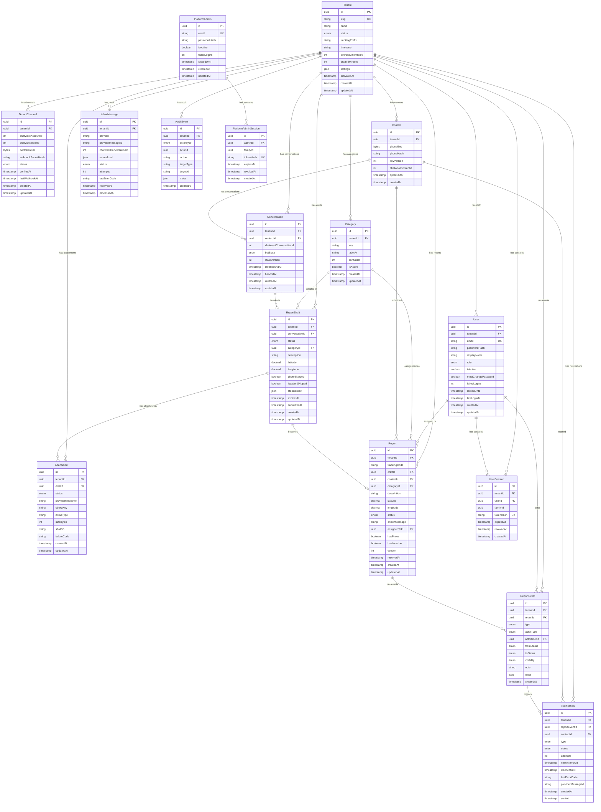

# 4. Database Design

## 4.1 Entity-Relationship Diagram

The schema has three logical zones: **Registry** (Tenant, TenantChannel), **Identity** (User, PlatformAdmin, sessions), and **Operations** (Contact, Conversation, ReportDraft, Report, events, notifications, inbox). Every tenant-owned table carries `tenantId`. Platform-level tables (Tenant, PlatformAdmin, PlatformAdminSession) deliberately do not.



---

## 4.2 Prisma Schema

The authoritative Prisma schema is at [`schema.prisma`](file:///d:/Cineplawin-Connect/schema.prisma) in the repository root. Additional constraints that Prisma cannot express are in [`constraints-and-roles.sql`](file:///d:/Cineplawin-Connect/constraints-and-roles.sql).

### Schema Design Highlights

| Design Decision | Implementation |
|---|---|
| **Composite foreign keys for tenant isolation** | Every child table references its parent via `(tenantId, parentId)` pointing to `@@unique([tenantId, id])` on the parent. This makes cross-tenant FK references structurally impossible. |
| **Two database roles** | `cc_owner` (migrations only, via `directUrl`) and `cc_app` (runtime, via `url`). `cc_app` has explicit per-table grants — a new table without a grant fails closed. |
| **Append-only tables** | `ReportEvent` and `AuditEvent` have triggers blocking UPDATE/DELETE, plus `cc_app` lacks those privileges. |
| **Soft-deactivation over deletion** | Categories use `isActive` flag. Users use `isActive`. Tenants use `status` enum. No hard deletes except for operational data (sessions, expired drafts, inbox). |
| **Optimistic concurrency** | `Report.version` and `Conversation.stateVersion` for concurrent update detection. |
| **Encrypted PII** | `Contact.phoneEnc` (AES-256-GCM) + `Contact.phoneHash` (HMAC-SHA256 blind index) + `Contact.keyVersion` for key rotation. |
| **Bot state in Postgres** | `Conversation.botState` is the durable source of truth. Redis may cache it for speed, but Postgres is authoritative. |

### Enums Summary

| Enum | Values | Usage |
|---|---|---|
| `TenantStatus` | DISABLED, ACTIVE, SUSPENDED | Tenant lifecycle |
| `ChannelStatus` | PENDING_VERIFICATION, VERIFIED, DISABLED | Chatwoot channel state |
| `UserRole` | TENANT_ADMIN, AGENT | Dashboard staff roles (SUPER_ADMIN is separate model) |
| `ReportStatus` | NEW, IN_REVIEW, IN_PROGRESS, RESOLVED, REJECTED | Report lifecycle |
| `BotState` | IDLE, AWAITING_CATEGORY, ..., HANDOFF | Bot conversation state machine |
| `DraftStatus` | ACTIVE, SUBMITTED, CANCELLED, EXPIRED | Draft lifecycle |
| `AttachmentStatus` | PENDING, STORED, FAILED, PURGED | Media pipeline state |
| `ReportEventType` | CREATED, STATUS_CHANGED, ASSIGNED, NOTE_ADDED | Immutable event types |
| `ActorType` | CITIZEN, USER, PLATFORM_ADMIN, SYSTEM | Who caused the event |
| `EventVisibility` | PUBLIC, INTERNAL | Whether citizen can see the event |
| `NotificationType` | REPORT_CONFIRMATION, STATUS_UPDATE, RESOLUTION_UPDATE | Outbound message types |
| `NotificationStatus` | PENDING, SENT, FAILED, FAILED_POLICY, CANCELLED | Outbox delivery state |
| `InboxStatus` | RECEIVED, PROCESSED, FAILED | Inbound webhook processing state |

---

## 4.3 Index Strategy

### Prisma-Declared Indexes

| Table | Index | Type | Justification |
|---|---|---|---|
| `TenantChannel` | `(chatwootAccountId, chatwootInboxId)` | UNIQUE | Webhook tenant resolution — the only lookup path. Must be fast and unique. |
| `TenantChannel` | `(tenantId)` | INDEX | List channels for a tenant. |
| `User` | `(email)` | UNIQUE | Login lookup — globally unique so login needs no tenant selector. |
| `User` | `(tenantId, id)` | UNIQUE | Composite FK target for children (Report.assignedTo, ReportEvent.actorUser). |
| `User` | `(tenantId, role, isActive)` | INDEX | List active agents for assignment dropdown. |
| `UserSession` | `(tokenHash)` | UNIQUE | Refresh token lookup. |
| `UserSession` | `(tenantId, userId)` | INDEX | List sessions for a user (revocation). |
| `UserSession` | `(familyId)` | INDEX | Rotate/revoke a token family on reuse detection. |
| `Category` | `(tenantId, id)` | UNIQUE | Composite FK target. |
| `Category` | `(tenantId, key)` | UNIQUE | Stable category identifier per tenant. |
| `Category` | `(tenantId, isActive, sortOrder)` | INDEX | Load active categories in display order for bot menu. |
| `Contact` | `(tenantId, id)` | UNIQUE | Composite FK target. |
| `Contact` | `(tenantId, phoneHash)` | UNIQUE | Lookup by phone (via HMAC blind index). Must be unique per tenant. |
| `Conversation` | `(tenantId, id)` | UNIQUE | Composite FK target. |
| `Conversation` | `(tenantId, chatwootConversationId)` | UNIQUE | Map Chatwoot conversation to local conversation. |
| `Conversation` | `(tenantId, contactId)` | INDEX | Find conversations for a contact. |
| `ReportDraft` | `(tenantId, id)` | UNIQUE | Composite FK target. |
| `ReportDraft` | `(tenantId, conversationId)` | INDEX | Find drafts for a conversation. |
| `Attachment` | `(tenantId, draftId)` | INDEX | List attachments for a draft. |
| `Report` | `(tenantId, id)` | UNIQUE | Composite FK target. |
| `Report` | `(tenantId, trackingCode)` | UNIQUE | Tracking code lookup — the citizen-facing query. |
| `Report` | `(tenantId, draftId)` | UNIQUE | One report per draft (idempotent submit). |
| `Report` | `(tenantId, status, createdAt)` | INDEX | Dashboard: filter by status, sort by date. |
| `Report` | `(tenantId, createdAt)` | INDEX | Dashboard: list all reports chronologically. |
| `Report` | `(tenantId, assignedToId)` | INDEX | Dashboard: filter by assigned agent. |
| `Report` | `(tenantId, contactId)` | INDEX | Find reports for a contact (tracking). |
| `ReportEvent` | `(tenantId, id)` | UNIQUE | Composite FK target. |
| `ReportEvent` | `(tenantId, reportId, createdAt)` | INDEX | Report timeline in the dashboard. |
| `Notification` | `(tenantId, reportEventId, type)` | UNIQUE | Exactly one notification per event+type (idempotency). |
| `InboxMessage` | `(tenantId, provider, providerMessageId)` | UNIQUE | Webhook deduplication. |
| `InboxMessage` | `(tenantId, status, receivedAt)` | INDEX | Process unprocessed messages. |
| `InboxMessage` | `(tenantId, chatwootConversationId, receivedAt)` | INDEX | Conversation message history. |
| `AuditEvent` | `(tenantId, createdAt)` | INDEX | Audit log browsing. |
| `AuditEvent` | `(tenantId, action, createdAt)` | INDEX | Filter audit log by action type. |

### SQL-Only Indexes (from constraints-and-roles.sql)

| Index | Type | Justification |
|---|---|---|
| `ReportDraft_one_active_per_conversation` | UNIQUE PARTIAL (WHERE status='ACTIVE') | Enforce at most one active draft per conversation. Prisma cannot express partial unique indexes. |
| `ReportDraft_active_expiry` | INDEX PARTIAL (WHERE status='ACTIVE') | Draft expiry sweep job — scans only active drafts. |
| `Notification_due` | INDEX PARTIAL (WHERE status='PENDING') | Outbox poller — only pending notifications. |
| `InboxMessage_unprocessed` | INDEX PARTIAL (WHERE status='RECEIVED') | Inbox sweeper — only unprocessed messages. |

### Index Count Assessment

Total: ~30 indexes across 15 tables. This is appropriate for the query patterns. At pilot scale (hundreds of reports, not millions), the write overhead is negligible. The partial indexes are particularly valuable because they keep the hot working set small.

---

## 4.4 Tracking Code Generation Strategy

### Requirements
- Human-friendly: easy to read aloud, type on a phone, and dictate over a call.
- Collision-safe: no duplicates per tenant, without requiring a global sequence.
- Not guessable: an adversary should not be able to enumerate valid codes.
- Format: `{PREFIX}-{6 alphanumeric chars}` e.g., `SBL-K7HN3R`.

### Alphabet
Exclude visually ambiguous characters: `0, 1, I, L, O`. This leaves 27 characters:
`2 3 4 5 6 7 8 9 A B C D E F G H J K M N P Q R S T U V W X Y Z`

Wait — that's 31 characters. Let me be precise:
- Digits: `2 3 4 5 6 7 8 9` (8 chars, excluding 0 and 1)
- Letters: `A B C D E F G H J K M N P Q R S T U V W X Y Z` (23 chars, excluding I, L, O)
- Total: **31 characters**

### Capacity
- 6 characters from an alphabet of 31: 31^6 = **887,503,681** possible codes per prefix.
- At 1000 reports/month, this lasts ~74,000 years. Collisions are not a practical concern.

### Generation Algorithm

```typescript
import { randomBytes } from 'node:crypto';

const ALPHABET = '23456789ABCDEFGHJKMNPQRSTUVWXYZ'; // 31 chars

function generateTrackingCode(prefix: string, length = 6): string {
  const bytes = randomBytes(length);
  const chars = Array.from(bytes, (b) => ALPHABET[b % ALPHABET.length]);
  // Note: modulo bias is negligible (256 % 31 = 8, bias < 3.2%)
  // For a tracking code (not a cryptographic key), this is acceptable.
  return `${prefix}-${chars.join('')}`;
}
```

### Collision Handling

The `@@unique([tenantId, trackingCode])` constraint guarantees no duplicates. The insert transaction catches the unique violation and retries with a new code (max 3 attempts). At 31^6 possible codes, the probability of a collision on the first attempt is astronomically low until hundreds of millions of reports exist.

### Database CHECK Constraint

From `constraints-and-roles.sql`:
```sql
ALTER TABLE "Report"
  ADD CONSTRAINT report_tracking_code_format
    CHECK ("trackingCode" ~ '^[A-Z]{2,4}-[2-9A-HJKMNP-Z]{6}$');
```

This validates the format at the database level, ensuring no malformed codes are ever persisted regardless of application bugs.

---

## 4.5 Seed Data Plan

### Demo Tenant

```typescript
// seed.ts
const DEMO_TENANT = {
  slug: 'sunbullawein-clinic',
  name: 'عيادة السنبلاوين',
  status: 'ACTIVE',
  trackingPrefix: 'SBL',
  timezone: 'Africa/Cairo',
  overdueAfterHours: 72,
  draftTtlMinutes: 30,
  settings: {
    workingHours: {
      saturday: { open: '09:00', close: '17:00' },
      sunday: { open: '09:00', close: '17:00' },
      monday: { open: '09:00', close: '17:00' },
      tuesday: { open: '09:00', close: '17:00' },
      wednesday: { open: '09:00', close: '17:00' },
      thursday: { open: '09:00', close: '17:00' },
      friday: null, // closed
    },
    directory: {
      address: 'شارع الجمهورية، السنبلاوين، الدقهلية',
      phone: '+20XXXXXXXXXX',
    },
    privacyPolicyUrl: null,
    notifyOnStatuses: ['IN_REVIEW', 'IN_PROGRESS', 'RESOLVED', 'REJECTED'],
  },
};
```

### Default Categories (for a municipal/civic pilot)

```typescript
const CATEGORIES = [
  { key: 'lighting',    labelAr: 'إنارة (أعمدة نور)',      sortOrder: 1 },
  { key: 'water',       labelAr: 'مياه (انقطاع / تسريب)',   sortOrder: 2 },
  { key: 'sewage',      labelAr: 'صرف صحي',                sortOrder: 3 },
  { key: 'cleanliness', labelAr: 'نظافة (قمامة / شوارع)',   sortOrder: 4 },
  { key: 'roads',       labelAr: 'طرق (حفر / أرصفة)',       sortOrder: 5 },
  { key: 'other',       labelAr: 'أخرى',                    sortOrder: 6 },
];
```

### For a Clinic Tenant (alternative seed)

```typescript
const CLINIC_CATEGORIES = [
  { key: 'medical',       labelAr: 'شكوى طبية',       sortOrder: 1 },
  { key: 'administrative', labelAr: 'شكوى إدارية',     sortOrder: 2 },
  { key: 'billing',       labelAr: 'فواتير / مالية',    sortOrder: 3 },
  { key: 'suggestion',    labelAr: 'اقتراح / تحسين',    sortOrder: 4 },
  { key: 'other',         labelAr: 'أخرى',              sortOrder: 5 },
];
```

### Demo Users

```typescript
const DEMO_USERS = [
  {
    email: 'admin@demo.cityconnect.local',
    displayName: 'دكتور حسن',
    role: 'TENANT_ADMIN',
    mustChangePassword: true,
    // password: 'ChangeMe123!' (hashed with argon2id)
  },
  {
    email: 'agent@demo.cityconnect.local',
    displayName: 'محمد',
    role: 'AGENT',
    mustChangePassword: true,
  },
];
```

### Sample Reports (dev/staging only)

```typescript
const SAMPLE_REPORTS = [
  {
    trackingCode: 'SBL-K7HN3R',
    category: 'lighting',
    description: 'عمود النور اللي قدام مدرسة النور مطفي من أسبوع',
    status: 'IN_PROGRESS',
    latitude: 31.0897,
    longitude: 31.3989,
  },
  {
    trackingCode: 'SBL-M4TP2X',
    category: 'water',
    description: 'مفيش مية من الساعة 6 الصبح',
    status: 'NEW',
    latitude: 31.0910,
    longitude: 31.4012,
  },
  {
    trackingCode: 'SBL-R9FW5D',
    category: 'cleanliness',
    description: 'القمامة متجمعة في الشارع من 3 أيام',
    status: 'RESOLVED',
    latitude: 31.0882,
    longitude: 31.3975,
  },
];
```

### Seed Execution

```bash
# Development
pnpm --filter @cc/api prisma db seed

# Production (first-time only)
# Seed the platform admin and one tenant via a CLI command:
pnpm --filter @cc/api cli:seed-tenant -- --slug sunbullawein-clinic --prefix SBL
```

The seed script is idempotent (uses upsert by slug/email).

---

## 4.6 Migration Plan

### Migration to PostGIS

**When:** When the map needs spatial queries (nearest reports, radius search, polygon filtering). Not needed for v1 — plain `lat`/`lng` columns with client-side filtering are sufficient for hundreds of reports in one city.

**Steps:**

1. **Add PostGIS extension** (requires superuser):
   ```sql
   CREATE EXTENSION IF NOT EXISTS postgis;
   ```

2. **Add geometry column** (migration):
   ```sql
   ALTER TABLE "Report" ADD COLUMN location geometry(Point, 4326);
   ALTER TABLE "ReportDraft" ADD COLUMN location geometry(Point, 4326);
   ```

3. **Backfill** from existing lat/lng:
   ```sql
   UPDATE "Report"
   SET location = ST_SetSRID(ST_MakePoint(longitude::float, latitude::float), 4326)
   WHERE latitude IS NOT NULL AND longitude IS NOT NULL;
   ```

4. **Add spatial index**:
   ```sql
   CREATE INDEX "Report_location_gist" ON "Report" USING gist(location);
   ```

5. **Update application code** to write both lat/lng and geometry on insert, then eventually drop the plain columns.

**Risks:**
- PostGIS adds ~100 MB to the Docker image and requires the extension to be installed at the server level (not just per-database).
- Prisma has no native PostGIS support — spatial queries must use `$queryRaw`.
- Test the backfill migration on a copy of production data before running it live.

### Migration to Row-Level Security

**When:** Before activating tenant #2. The activation gate in `constraints-and-roles.sql` (Section C4) blocks this automatically.

**Steps:**

1. **Run Section C of constraints-and-roles.sql** (the commented-out block):
   - Create `cc_current_tenant()` function.
   - Enable and force RLS on all 9 tenant-owned tables.
   - Create `tenant_isolation` policy on each.

2. **Update application code**: every Prisma `$transaction` must call `SET LOCAL app.tenant_id = $tenantId` before any query.

3. **Test**: run the full cross-tenant isolation test suite with RLS enabled, as `cc_app`. Add a negative test: a query with no `app.tenant_id` set returns 0 rows.

4. **Verify the activation gate** query returns `true` (all tables have RLS enabled and forced).

**Risks:**
- Prisma `$transaction` with interactive transactions is required (not the sequential API). Verify Prisma version support.
- Any raw SQL that doesn't set the tenant context will silently return no rows (fail closed, which is correct but can be confusing to debug).
- Performance: RLS adds a filter to every query. At pilot scale, negligible. Monitor if tenant count grows significantly.

---

## 4.7 Data Retention, Backup, and Restore Strategy

### Retention Policy

| Data Type | Retention | Deletion Method |
|---|---|---|
| **Reports + ReportEvents** | Indefinite (part of the audit trail) | Only via formal data-subject erasure request (PDPL Art. 4) |
| **Attachments (photos)** | Same as report | Object storage delete + DB record tombstone |
| **ReportDrafts** (CANCELLED/EXPIRED) | 7 days after expiry | Scheduled cleanup job |
| **Attachments on expired drafts** | 7 days after draft expiry | Object storage delete + DB record delete |
| **InboxMessage** | 30 days after processing | Scheduled cleanup job (`processedAt + 30 days`) |
| **Notification** (SENT) | 90 days | Scheduled cleanup job |
| **Notification** (FAILED) | Indefinite until manually reviewed | Super admin review + manual purge |
| **UserSession / PlatformAdminSession** | 30 days after expiry or revocation | Scheduled cleanup job |
| **AuditEvent** | Indefinite (compliance requirement) | Only via formal procedure with audit trail |
| **Contact** | Until opt-out or erasure request | Anonymization: clear phoneEnc, keep phoneHash for dedup |

### Backup Strategy

| Component | Method | Schedule | Retention |
|---|---|---|---|
| PostgreSQL (cc database) | `pg_dump --format=custom` | Daily at 03:00 Cairo time | 7 daily + 4 weekly |
| PostgreSQL (Chatwoot DB) | `pg_dump --format=custom` | Daily at 03:00 | 7 daily + 4 weekly |
| Object storage (MinIO/R2) | `rclone sync` to off-site | Daily at 04:00 | 7 daily |
| Secrets / .env | Manual encrypted copy | On every change | Current + 1 previous |
| Docker Compose + config | Git repository | On every change | Full history |

### Backup Script

```bash
#!/bin/bash
# scripts/backup.sh — run daily via cron or systemd timer
set -euo pipefail

DATE=$(date +%Y%m%d_%H%M%S)
BACKUP_DIR="/backups/daily"
OFFSITE_DIR="remote:cc-backups/daily"  # rclone remote

# PostgreSQL (app)
docker exec cc-postgres pg_dump -U cc_owner -Fc cc \
  > "${BACKUP_DIR}/cc_${DATE}.dump"

# PostgreSQL (Chatwoot)
docker exec cc-postgres pg_dump -U postgres -Fc chatwoot_production \
  > "${BACKUP_DIR}/chatwoot_${DATE}.dump"

# Encrypt
gpg --symmetric --cipher-algo AES256 --batch --passphrase-file /etc/cc/backup.key \
  "${BACKUP_DIR}/cc_${DATE}.dump"
gpg --symmetric --cipher-algo AES256 --batch --passphrase-file /etc/cc/backup.key \
  "${BACKUP_DIR}/chatwoot_${DATE}.dump"
rm "${BACKUP_DIR}/cc_${DATE}.dump" "${BACKUP_DIR}/chatwoot_${DATE}.dump"

# Object storage
rclone sync /data/minio/cc-media "${OFFSITE_DIR}/media_${DATE}" --transfers 4

# Upload encrypted dumps
rclone copy "${BACKUP_DIR}" "${OFFSITE_DIR}" --include "*.gpg"

# Prune old backups (keep 7 daily, 4 weekly)
find "${BACKUP_DIR}" -name "*.gpg" -mtime +7 -delete
```

### Restore Procedure (Tested)

This procedure must be tested on a clean VPS **before the pilot launch**. Document the actual time it takes.

```bash
# 1. Provision a fresh VPS with Docker installed
# 2. Clone the repo and copy the .env and secrets

# 3. Decrypt the backup
gpg --decrypt --batch --passphrase-file /etc/cc/backup.key \
  cc_20261015_030000.dump.gpg > cc_restore.dump

# 4. Start only Postgres
docker compose up -d postgres

# 5. Create roles (Section A of constraints-and-roles.sql)
docker exec -i cc-postgres psql -U postgres < scripts/bootstrap-roles.sql

# 6. Restore the app database
docker exec -i cc-postgres pg_restore -U cc_owner -d cc --clean --if-exists < cc_restore.dump

# 7. Restore Chatwoot database
docker exec -i cc-postgres pg_restore -U postgres -d chatwoot_production --clean --if-exists < chatwoot_restore.dump

# 8. Restore object storage
rclone sync remote:cc-backups/daily/media_latest /data/minio/cc-media

# 9. Start all services
docker compose up -d

# 10. Verify
curl -f https://your-domain.com/api/healthz
curl -f https://your-domain.com/api/readyz
# Log into dashboard and verify report list loads
# Send a test WhatsApp message and verify bot responds
```

**Target restore time:** < 2 hours (based on small data volumes at pilot scale).

---

## Section 4 — Open Issues / Needs Verification

| # | Item | Source to Check |
|---|---|---|
| NV-15 | Run `prisma format && prisma validate` on the existing schema — it was written without Prisma available | First development task |
| NV-16 | Verify composite optional FK on ReportDraft.category works in current Prisma version | Prisma docs / `prisma validate` output |
| NV-17 | PostGIS Docker image compatibility with the chosen PostgreSQL version | postgres/postgis Docker Hub tags |
| NV-18 | Prisma interactive transactions with `SET LOCAL` for RLS | Prisma docs on interactive transactions |
| NV-19 | Off-site backup destination (which rclone remote — Backblaze B2, Hetzner Storage Box, etc.) | Pricing comparison based on estimated data volume |
