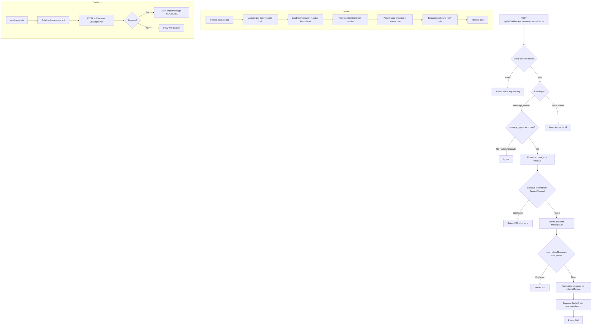

# 5. API Design

## 5.1 REST Endpoints by Module

> **Conventions:**
> - All endpoints prefixed with `/api/v1` (except health checks at `/api`).
> - Tenant-scoped endpoints automatically filter by the authenticated user's `tenantId` — no tenant ID in the URL path.
> - Platform admin endpoints use prefix `/api/v1/platform`.
> - `SA` = Super Admin (PlatformAdmin), `TA` = Tenant Admin, `AG` = Agent.

### Health

| Method | Path | Roles | Purpose |
|---|---|---|---|
| GET | `/api/healthz` | Public | Process alive check (returns 200 if server is running) |
| GET | `/api/readyz` | Public | Deep check: Postgres, Redis, object storage reachable |

### Auth

| Method | Path | Roles | Purpose |
|---|---|---|---|
| POST | `/api/v1/auth/login` | Public | Authenticate with email + password, return access + refresh tokens |
| POST | `/api/v1/auth/refresh` | Public (refresh token) | Rotate refresh token, return new access token |
| POST | `/api/v1/auth/logout` | TA, AG | Revoke current refresh token family |
| POST | `/api/v1/auth/change-password` | TA, AG | Change own password, revoke all sessions |
| POST | `/api/v1/platform/auth/login` | Public | Platform admin login (separate endpoint, separate token issuer) |
| POST | `/api/v1/platform/auth/refresh` | Public (refresh token) | Platform admin refresh |

### Tenants (Platform Admin)

| Method | Path | Roles | Purpose |
|---|---|---|---|
| GET | `/api/v1/platform/tenants` | SA | List all tenants with status |
| POST | `/api/v1/platform/tenants` | SA | Create a new tenant |
| GET | `/api/v1/platform/tenants/:id` | SA | Get tenant details |
| PATCH | `/api/v1/platform/tenants/:id` | SA | Update tenant settings, status |
| POST | `/api/v1/platform/tenants/:id/activate` | SA | Activate tenant (checks RLS gate for 2nd+ tenant) |
| POST | `/api/v1/platform/tenants/:id/channels` | SA | Add a Chatwoot channel to tenant |

### Users (Tenant Admin)

| Method | Path | Roles | Purpose |
|---|---|---|---|
| GET | `/api/v1/users` | TA | List staff users for this tenant |
| POST | `/api/v1/users` | TA | Create a new agent or admin |
| GET | `/api/v1/users/:id` | TA | Get user details |
| PATCH | `/api/v1/users/:id` | TA | Update user (role, displayName, isActive) |
| POST | `/api/v1/users/:id/reset-password` | TA | Reset user password (generates temporary password) |
| GET | `/api/v1/users/me` | TA, AG | Get current authenticated user profile |

### Categories

| Method | Path | Roles | Purpose |
|---|---|---|---|
| GET | `/api/v1/categories` | TA, AG | List active categories for this tenant |
| POST | `/api/v1/categories` | TA | Create a category |
| PATCH | `/api/v1/categories/:id` | TA | Update category (labelAr, sortOrder, isActive) |

### Reports

| Method | Path | Roles | Purpose |
|---|---|---|---|
| GET | `/api/v1/reports` | TA, AG | List reports (paginated, filterable, sortable) |
| GET | `/api/v1/reports/:id` | TA, AG | Get report detail with events and attachments |
| PATCH | `/api/v1/reports/:id/status` | TA, AG | Change report status (+ optional citizenMessage) |
| PATCH | `/api/v1/reports/:id/assign` | TA | Assign report to an agent |

### Report Events

| Method | Path | Roles | Purpose |
|---|---|---|---|
| GET | `/api/v1/reports/:id/events` | TA, AG | List events for a report (timeline) |
| POST | `/api/v1/reports/:id/events` | TA, AG | Add a note (type=NOTE_ADDED, visibility=INTERNAL or PUBLIC) |

### Attachments

| Method | Path | Roles | Purpose |
|---|---|---|---|
| GET | `/api/v1/attachments/:id/url` | TA, AG | Get a signed URL for viewing the attachment (short-lived, 5 min) |

### Analytics (v1 basic — Should Have S4)

| Method | Path | Roles | Purpose |
|---|---|---|---|
| GET | `/api/v1/analytics/summary` | TA | Aggregated stats: total, by status, avg resolution time, by category |

### Webhooks (Chatwoot Inbound)

| Method | Path | Roles | Purpose |
|---|---|---|---|
| POST | `/api/v1/webhooks/chatwoot/:channelSecret` | Chatwoot (verified) | Receive Agent Bot webhook events |

### Audit (Platform Admin)

| Method | Path | Roles | Purpose |
|---|---|---|---|
| GET | `/api/v1/platform/audit` | SA | List audit events (paginated, filterable by action, tenant) |
| GET | `/api/v1/platform/audit/:tenantId` | SA | Audit events for a specific tenant |

---

## 5.2 Request/Response Examples (6 Most Important Endpoints)

### 1. POST `/api/v1/auth/login`

**Request:**
```json
{
  "email": "mohamed@clinic.example.com",
  "password": "SecureP@ss123"
}
```

**Validation rules:**
- `email`: required, string, valid email format, lowercased + trimmed
- `password`: required, string, min 8 chars

**Response (200):**
```json
{
  "accessToken": "eyJhbGciOiJIUzI1NiIs...",
  "refreshToken": "rt_a8f3k2m9x7p4q1w6...",
  "expiresIn": 900,
  "user": {
    "id": "550e8400-e29b-41d4-a716-446655440001",
    "email": "mohamed@clinic.example.com",
    "displayName": "محمد",
    "role": "AGENT",
    "tenantId": "550e8400-e29b-41d4-a716-446655440000",
    "mustChangePassword": false
  }
}
```

**Response (401):**
```json
{
  "error": {
    "code": "AUTH_INVALID_CREDENTIALS",
    "message": "بيانات غير صحيحة",
    "statusCode": 401
  }
}
```

**Response (423 — locked):**
```json
{
  "error": {
    "code": "AUTH_ACCOUNT_LOCKED",
    "message": "الحساب مقفول. حاول تاني بعد 15 دقيقة.",
    "statusCode": 423,
    "details": {
      "lockedUntil": "2026-10-11T14:30:00Z"
    }
  }
}
```

---

### 2. GET `/api/v1/reports`

**Query parameters:**

| Parameter | Type | Default | Description |
|---|---|---|---|
| `page` | int | 1 | Page number (1-indexed) |
| `limit` | int | 20 | Items per page (max 100) |
| `status` | string | — | Filter by status: `NEW`, `IN_REVIEW`, `IN_PROGRESS`, `RESOLVED`, `REJECTED` |
| `categoryId` | uuid | — | Filter by category |
| `assignedToId` | uuid | — | Filter by assigned agent |
| `dateFrom` | ISO date | — | Reports created on or after |
| `dateTo` | ISO date | — | Reports created on or before |
| `sort` | string | `-createdAt` | Sort field. Prefix `-` for descending. Allowed: `createdAt`, `status`, `trackingCode` |
| `search` | string | — | Search in trackingCode or description |

**Response (200):**
```json
{
  "data": [
    {
      "id": "550e8400-e29b-41d4-a716-446655440010",
      "trackingCode": "SBL-K7HN3R",
      "category": {
        "id": "...",
        "key": "lighting",
        "labelAr": "إنارة (أعمدة نور)"
      },
      "description": "عمود النور اللي قدام مدرسة النور مطفي من أسبوع",
      "status": "IN_PROGRESS",
      "hasPhoto": true,
      "hasLocation": true,
      "latitude": 31.0897,
      "longitude": 31.3989,
      "assignedTo": {
        "id": "...",
        "displayName": "محمد"
      },
      "createdAt": "2026-10-10T09:15:00Z",
      "updatedAt": "2026-10-11T14:00:00Z"
    }
  ],
  "pagination": {
    "page": 1,
    "limit": 20,
    "total": 47,
    "totalPages": 3
  }
}
```

---

### 3. PATCH `/api/v1/reports/:id/status`

**Request:**
```json
{
  "status": "RESOLVED",
  "citizenMessage": "تم إصلاح عمود النور",
  "visibility": "PUBLIC",
  "version": 2
}
```

**Validation rules:**
- `status`: required, must be a valid `ReportStatus` enum value
- `citizenMessage`: required when status is `REJECTED`, optional otherwise, max 500 chars
- `visibility`: optional, default `INTERNAL`, enum: `PUBLIC` | `INTERNAL`
- `version`: required, must match current `Report.version` (optimistic concurrency)

**Allowed transitions:**

| From | Allowed To |
|---|---|
| NEW | IN_REVIEW, REJECTED |
| IN_REVIEW | IN_PROGRESS, RESOLVED, REJECTED |
| IN_PROGRESS | RESOLVED, REJECTED |
| RESOLVED | — (terminal) |
| REJECTED | — (terminal) |

**Response (200):**
```json
{
  "data": {
    "id": "550e8400-e29b-41d4-a716-446655440010",
    "trackingCode": "SBL-K7HN3R",
    "status": "RESOLVED",
    "version": 3,
    "resolvedAt": "2026-10-11T14:05:00Z",
    "updatedAt": "2026-10-11T14:05:00Z"
  }
}
```

**Response (409 — version conflict):**
```json
{
  "error": {
    "code": "REPORT_VERSION_CONFLICT",
    "message": "البلاغ اتعدل من حد تاني. حدّث الصفحة وحاول تاني.",
    "statusCode": 409,
    "details": {
      "currentVersion": 3
    }
  }
}
```

**Response (422 — invalid transition):**
```json
{
  "error": {
    "code": "REPORT_INVALID_TRANSITION",
    "message": "مينفعش تغير الحالة من RESOLVED",
    "statusCode": 422,
    "details": {
      "currentStatus": "RESOLVED",
      "requestedStatus": "IN_PROGRESS"
    }
  }
}
```

**Side effects (in one transaction):**
1. Update Report: status, version++, resolvedAt (if RESOLVED), citizenMessage
2. Insert ReportEvent: STATUS_CHANGED, fromStatus, toStatus, actorType=USER, note
3. Insert AuditEvent: action="report.status_changed"
4. Insert Notification: type depends on new status (STATUS_UPDATE or RESOLUTION_UPDATE)

---

### 4. PATCH `/api/v1/reports/:id/assign`

**Request:**
```json
{
  "assignedToId": "550e8400-e29b-41d4-a716-446655440001",
  "version": 2
}
```

**Validation rules:**
- `assignedToId`: required, uuid, must be an active user in the same tenant with role AGENT or TENANT_ADMIN
- `version`: required, optimistic concurrency

**Response (200):**
```json
{
  "data": {
    "id": "550e8400-e29b-41d4-a716-446655440010",
    "assignedTo": {
      "id": "550e8400-e29b-41d4-a716-446655440001",
      "displayName": "محمد"
    },
    "version": 3,
    "updatedAt": "2026-10-11T14:10:00Z"
  }
}
```

---

### 5. GET `/api/v1/reports/:id`

**Response (200):**
```json
{
  "data": {
    "id": "550e8400-e29b-41d4-a716-446655440010",
    "trackingCode": "SBL-K7HN3R",
    "category": {
      "id": "...",
      "key": "lighting",
      "labelAr": "إنارة (أعمدة نور)"
    },
    "description": "عمود النور اللي قدام مدرسة النور مطفي من أسبوع",
    "status": "IN_PROGRESS",
    "citizenMessage": null,
    "latitude": 31.0897,
    "longitude": 31.3989,
    "version": 2,
    "assignedTo": {
      "id": "...",
      "displayName": "محمد"
    },
    "attachments": [
      {
        "id": "...",
        "status": "STORED",
        "mimeType": "image/jpeg",
        "sizeBytes": 245000,
        "signedUrl": "https://storage.example.com/tenants/...?X-Amz-Expires=300&...",
        "signedUrlExpiresAt": "2026-10-11T14:15:00Z"
      }
    ],
    "events": [
      {
        "id": "...",
        "type": "CREATED",
        "actorType": "SYSTEM",
        "visibility": "PUBLIC",
        "note": null,
        "createdAt": "2026-10-10T09:15:00Z"
      },
      {
        "id": "...",
        "type": "STATUS_CHANGED",
        "actorType": "USER",
        "actorUser": { "displayName": "محمد" },
        "fromStatus": "NEW",
        "toStatus": "IN_REVIEW",
        "visibility": "INTERNAL",
        "note": "تم استلام البلاغ ومحتاج فريق صيانة",
        "createdAt": "2026-10-10T10:30:00Z"
      },
      {
        "id": "...",
        "type": "STATUS_CHANGED",
        "actorType": "USER",
        "actorUser": { "displayName": "محمد" },
        "fromStatus": "IN_REVIEW",
        "toStatus": "IN_PROGRESS",
        "visibility": "PUBLIC",
        "note": "تم إرسال فريق الصيانة",
        "createdAt": "2026-10-11T08:00:00Z"
      }
    ],
    "createdAt": "2026-10-10T09:15:00Z",
    "updatedAt": "2026-10-11T08:00:00Z"
  }
}
```

---

### 5.1 POST `/api/v1/reports/:id/undo-status` (15-Second Grace Window Undo)

**Purpose:** Allows staff to immediately reverse an accidental status change (e.g. clicking "RESOLVED" by mistake) before the WhatsApp outbox message is physically dispatched to the citizen.

**Request:**
```json
{
  "version": 3
}
```

**Mechanics:**
1. Validates that current status change occurred within the last 15 seconds (`now() - updatedAt <= 15s`).
2. Cancels the delayed BullMQ outbox job `notify-status-${id}-${version}` if not yet processed.
3. Reverts `Report.status` to its previous state stored in the latest `ReportEvent.fromStatus`.
4. Appends a new `ReportEvent` of type `STATUS_CHANGED` with note: `"تم التراجع عن تغيير الحالة بواسطة الموظف خلال مهلة الـ 15 ثانية"`.
5. Deletes the pending `Notification` record or marks it `CANCELLED`.

**Response (200):**
```json
{
  "data": {
    "id": "550e8400-e29b-41d4-a716-446655440010",
    "status": "IN_PROGRESS",
    "version": 4,
    "message": "تم إلغاء التحديث بنجاح ولم يتم إرسال أي رسالة للمواطن"
  }
}
```

---

### 5.2 DELETE `/api/v1/reports/:id/attachments/:attachmentId` (Purge Accidental/Inappropriate Media)

**Purpose:** Allows staff/administrators to instantly purge an inappropriate, offensive, or accidental personal photo (such as a private selfie or national ID) uploaded by a citizen, while preserving the ticket details.

**Request:** (Empty body, authenticated as `STAFF` or `TENANT_ADMIN`).

**Mechanics:**
1. Deletes the physical binary object from MinIO S3 bucket immediately.
2. Updates `Attachment` status to `PURGED`, clearing `storagePath` and setting `mimeType = null`.
3. Sets `Report.hasPhoto = false` if no other valid attachments remain.
4. Records an immutable `AuditEvent` (`MEDIA_PURGED_BY_STAFF`) with admin ID, reason, and timestamp.

**Response (200):**
```json
{
  "data": {
    "attachmentId": "...",
    "status": "PURGED",
    "message": "تم حذف الملف نهائياً من خوادم التخزين"
  }
}
```

---

### 6. POST `/api/v1/webhooks/chatwoot/:channelSecret`

**Expected payload (message_created event):**

```json
{
  "event": "message_created",
  "id": 12345,
  "account": {
    "id": 1
  },
  "inbox": {
    "id": 2
  },
  "conversation": {
    "id": 789,
    "contact_id": 456,
    "status": "pending"
  },
  "message": {
    "id": 99999,
    "content": "1",
    "content_type": "text",
    "message_type": "incoming",
    "created_at": "2026-10-11T14:00:00Z",
    "sender": {
      "id": 456,
      "phone_number": "+201234567890"
    },
    "attachments": [],
    "content_attributes": {}
  }
}
```

**Response:** Always `200 OK` with empty body (or `{ "status": "ok" }`). Errors are logged internally, never exposed to Chatwoot.

> **NEEDS VERIFICATION**: The exact payload shape for Chatwoot Agent Bot webhooks — particularly how location messages, image attachments, and conversation status changes are represented. Test with the installed version.

---

## 5.3 Chatwoot Webhook Handler Pipeline



### Message Normalization & Infinite Loop Guard

The webhook payload is sanitized, guarded against infinite loops, and normalized to a typed internal format before processing:

```typescript
// Guard against Infinite Webhook Loops: Ignore system, outgoing, and staff private messages
export function shouldProcessWebhook(payload: ChatwootWebhookPayload): boolean {
  if (
    payload.event !== 'message_created' ||
    payload.message_type !== 'incoming' ||
    payload.private === true ||
    payload.sender?.type === 'agent_bot' ||
    payload.sender?.type === 'user'
  ) {
    return false; // Ignored immediately with HTTP 200 OK
  }
  return true;
}

// Normalizer converts Arabic-Indic digits (١، ٢، ٣) to Western digits (1, 2, 3)
export function normalizeText(rawText: string): string {
  return rawText
    .trim()
    .replace(/[٠-٩]/g, (d) => '٠١٢٣٤٥٦٧٨٩'.indexOf(d).toString());
}

export type NormalizedMessage =
  | { kind: 'text'; text: string }
  | { kind: 'audio'; mediaUrl: string; mimeType: string } // Voice note support for Persona Umm Ahmed
  | { kind: 'image'; mediaUrl: string; mimeType: string }
  | { kind: 'location'; latitude: number; longitude: number; name?: string; address?: string }
  | { kind: 'unsupported'; originalType: string };
```

This decouples the bot state machine from Chatwoot's payload format. Media files (both images and audio voice notes) are fetched by the worker directly from Chatwoot's authenticated attachment URL (`mediaUrl`), not from Meta Cloud API.

### Signature/Secret Verification

Two layers:

1. **Path secret**: The `:channelSecret` is a random 32-byte hex string stored as an HMAC hash in `TenantChannel.webhookSecretHash`. The webhook URL is `https://api.example.com/api/v1/webhooks/chatwoot/a1b2c3d4...`. This prevents enumeration.

2. **Payload verification** (if available): Check if the installed Chatwoot version sends a signature header (e.g., `X-Chatwoot-Signature`). If so, verify with HMAC-SHA256. **NEEDS VERIFICATION**.

3. **IP allowlisting**: If Chatwoot is on the same Docker network, restrict the webhook endpoint to the internal network IP range at the reverse proxy level.

### 5.3.1 Worker Resiliency & Stress-Tested Edge Cases

To prevent runtime failures under extreme conditions (as proven in stress-test scenarios), the BullMQ worker applies these rules:

```typescript
// 1. Rapid-Fire Message Debounce & Redis Distributed Locking (Scenario 1.1)
async function processInboundJob(job: Job<{ conversationId: string; messageId: string }>) {
  const lockKey = `lock:conv:${job.data.conversationId}`;
  const lock = await redis.set(lockKey, 'locked', 'NX', 'PX', 2500);
  if (!lock) {
    // Another worker is processing this conversation; delay job by 500ms
    throw new DelayedError(500);
  }

  try {
    // 2. Zombie Draft Auto-Expiry Guard (Scenario 1.2)
    const activeDraft = await prisma.reportDraft.findFirst({
      where: { conversationId: job.data.conversationId, status: 'ACTIVE' },
    });

    if (activeDraft && activeDraft.expiresAt < new Date()) {
      await prisma.$transaction([
        prisma.reportDraft.update({ where: { id: activeDraft.id }, data: { status: 'EXPIRED' } }),
        prisma.conversation.update({ where: { id: job.data.conversationId }, data: { botState: 'IDLE' } }),
      ]);
      // Conversation returned to IDLE; inbound message will trigger main menu
    }

    // 3. Media Download Timeout with Resilient Fallback (Scenario 2.2)
    // Downloads from Chatwoot media URL with strict 8-second AbortController
    // If download times out, mark Attachment status = 'FAILED' and continue without crashing draft

    // 4. Geo-Bounding Box Out-of-Bounds Flagging (Scenario 4.2)
    // If citizen sends a location pin outside tenant.settings.geoBounds (e.g. outside Dakahlia),
    // accept the pin but tag stepContext.isOutOfBounds = true to display a warning badge in dashboard.

  } finally {
    await redis.del(lockKey);
  }
}
```

### 5.3.2 Dynamic Congestion Backpressure (Scenario 1: Viral Traffic)

When incoming traffic surges (e.g. viral Facebook post), the webhook receiver checks BullMQ queue depth before enqueuing:
```typescript
const queueDepth = await incomingQueue.count();
if (queueDepth > 500) {
  // System under heavy viral surge: activate Degraded Mode
  // Bypass heavy state-machine DB queries and emit instant calming message via Chatwoot
  await chatwootClient.sendMessage(conversationId, {
    content: "📍 أهلاً بك، يوجد ضغط بلاغات مرتفع حالياً في منطقتك. رسالتك مسجلة في الطابور وسنرد عليك خلال دقائق.",
  });
  // Enqueue with lower priority
  await incomingQueue.add('process', payload, { priority: 10 });
  return { status: 'congested' };
}
```

### 5.3.3 Strict Lock Hierarchy & Deadlock Prevention (Scenario 4)

To prevent PostgreSQL deadlocks under high concurrency, all transactions touching multiple domain entities must strictly acquire locks and write in a singular descending order:
$$\text{Conversation} \longrightarrow \text{ReportDraft} \longrightarrow \text{Report} \longrightarrow \text{ReportEvent} \longrightarrow \text{Notification}$$
Transactions must never attempt reverse-order queries (e.g. locking `Notification` then querying `Conversation`). The outbox poller only mutates `Notification` rows and is completely decoupled from `Conversation` locks.

### 5.3.4 Public Web Tracking Fallback (Scenario 5: WhatsApp Ban)

If the tenant's WhatsApp Business number is suspended by Meta, citizens can track reports via web browser:

**Endpoint:** `POST /api/v1/public/track`
```json
{
  "trackingCode": "SBL-K7HN3R",
  "phoneLastFour": "7890"
}
```
**Response (200):**
```json
{
  "trackingCode": "SBL-K7HN3R",
  "category": "إنارة",
  "status": "IN_PROGRESS",
  "statusArabic": "جاري العمل",
  "createdAt": "2026-10-10T12:00:00Z",
  "lastUpdateNote": "تم توجيه فريق الصيانة"
}
```
*Security*: Verifies the last 4 digits of the submitter's phone number against the hashed contact, preventing unauthorized brute-force lookups.

---

## 5.4 Error Model

### Error Envelope

Every error response follows this format:

```typescript
interface ErrorResponse {
  error: {
    code: string;          // Machine-readable, e.g. "REPORT_NOT_FOUND"
    message: string;       // Human-readable, in Arabic for tenant endpoints
    statusCode: number;    // HTTP status code
    details?: Record<string, unknown>; // Optional context
    requestId?: string;    // Correlation ID for support
  };
}
```

### Error Codes

| Code | HTTP Status | When |
|---|---|---|
| `AUTH_INVALID_CREDENTIALS` | 401 | Wrong email or password |
| `AUTH_TOKEN_EXPIRED` | 401 | Access token expired |
| `AUTH_TOKEN_INVALID` | 401 | Malformed or tampered token |
| `AUTH_ACCOUNT_LOCKED` | 423 | Too many failed login attempts |
| `AUTH_REFRESH_REVOKED` | 401 | Refresh token reuse detected (family revoked) |
| `FORBIDDEN` | 403 | Insufficient role for this action |
| `NOT_FOUND` | 404 | Resource not found (or belongs to another tenant) |
| `VALIDATION_ERROR` | 422 | Request body validation failed |
| `REPORT_VERSION_CONFLICT` | 409 | Optimistic concurrency conflict |
| `REPORT_INVALID_TRANSITION` | 422 | Status transition not allowed |
| `REPORT_REJECTION_REQUIRES_MESSAGE` | 422 | REJECTED without citizenMessage |
| `RATE_LIMIT_EXCEEDED` | 429 | Too many requests |
| `INTERNAL_ERROR` | 500 | Unexpected server error (details logged, not exposed) |

### Pagination Convention

Offset-based pagination (simple, sufficient for pilot scale):

```typescript
interface PaginatedResponse<T> {
  data: T[];
  pagination: {
    page: number;      // Current page (1-indexed)
    limit: number;     // Items per page
    total: number;     // Total matching items
    totalPages: number; // ceil(total / limit)
  };
}
```

**Why not cursor-based?** Cursor pagination is better for infinite scroll and real-time feeds, but the dashboard uses table views with page numbers. Offset pagination is simpler and matches the UI. Migrate to cursor-based if performance degrades beyond ~10K reports per tenant.

### Filtering Convention

Filters are query parameters with exact names matching the field:

```
GET /api/v1/reports?status=NEW&categoryId=abc-123&dateFrom=2026-10-01&dateTo=2026-10-31
```

- Multiple values for the same field: `status=NEW&status=IN_REVIEW` (OR semantics).
- Date fields accept ISO 8601 date strings. Times are interpreted as start/end of day in the tenant's timezone.

### Sorting Convention

```
GET /api/v1/reports?sort=-createdAt        // descending
GET /api/v1/reports?sort=status,createdAt   // multi-sort
```

- Prefix `-` for descending.
- Comma-separated for multi-sort.
- Allowed sort fields are documented per endpoint (whitelist, not arbitrary).

---

## 5.5 Rate Limiting and Abuse Protection

### Per-Phone (Citizen via Bot)

| Limit | Value | Window | Action |
|---|---|---|---|
| Messages per minute | 10 | 1 min | Silently drop excess messages |
| Reports per day | 5 | 24h | Bot responds with "reached daily limit" message |
| Consecutive invalid inputs | 3 | Per conversation state | Offer to return to main menu |

**Implementation:** Redis sliding window counter keyed by `Contact.phoneHash` + tenant. Configurable per tenant via `tenant.settings.rateLimits`.

### Per-Tenant (Dashboard API)

| Limit | Value | Window | Action |
|---|---|---|---|
| API requests | 1000 | 1 min | Return 429 |
| Login attempts per user | 5 | 15 min | Lock account |

### Per-IP (Global)

| Limit | Value | Window | Action |
|---|---|---|---|
| Login endpoint | 20 | 15 min | Return 429 |
| Webhook endpoint | 100 | 1 min | Return 429 (protects against malformed retries) |
| All other endpoints | 300 | 1 min | Return 429 |

**Implementation:** Redis sliding window or fixed window per IP. NestJS `@nestjs/throttler` module or custom guard.

### Webhook Abuse Protection

- Only accept webhooks from known paths (`:channelSecret` must hash-match a TenantChannel).
- IP allowlist at reverse proxy level if Chatwoot is co-located.
- Payload size limit: 1 MB (reject larger payloads before parsing).
- JSON parsing with depth limit.

---

## 5.6 Versioning, OpenAPI, and Shared Types

### API Versioning

- Path-based: `/api/v1/...`.
- No version negotiation via headers (unnecessary complexity for a single-version MVP).
- When v2 is needed, deploy `/api/v2/...` alongside v1. Remove v1 only after all clients migrate.

### OpenAPI/Swagger Generation

Use `@nestjs/swagger` with decorators to auto-generate OpenAPI 3.0 spec from the NestJS controllers.

```typescript
// main.ts
import { SwaggerModule, DocumentBuilder } from '@nestjs/swagger';

const config = new DocumentBuilder()
  .setTitle('Wassel API')
  .setDescription('Multi-tenant civic engagement platform API (واصل)')
  .setVersion('1.0')
  .addBearerAuth()
  .build();

const document = SwaggerModule.createDocument(app, config);
SwaggerModule.setup('api/docs', app, document);
```

- Swagger UI available at `/api/docs` (disable in production or restrict to authenticated users).
- Export `openapi.json` as a CI artifact for contract testing.

### Shared Types Package

In the monorepo, create a shared package `@cc/shared` containing:

```
packages/shared/
  src/
    enums.ts          # ReportStatus, UserRole, BotState, etc.
    dto/
      auth.ts         # LoginDto, TokenResponse
      reports.ts      # ReportListQuery, ReportResponse, StatusUpdateDto
      webhooks.ts     # ChatwootWebhookPayload, NormalizedMessage
    errors.ts         # ErrorCode enum, ErrorResponse type
    pagination.ts     # PaginatedResponse<T>, PaginationQuery
    tracking-code.ts  # generateTrackingCode, TRACKING_CODE_REGEX
```

This package is imported by both `@cc/api` (backend) and `@cc/dashboard` (frontend), ensuring type consistency without runtime coupling.

```jsonc
// packages/shared/package.json
{
  "name": "@cc/shared",
  "version": "0.1.0",
  "main": "./dist/index.js",
  "types": "./dist/index.d.ts",
  "scripts": {
    "build": "tsc",
    "dev": "tsc --watch"
  }
}
```

### DTO Validation (Zod)

All request DTOs use Zod schemas for runtime validation. The Zod schemas are co-located with the DTOs in `@cc/shared` and used in both NestJS (via `ZodValidationPipe`) and the frontend (form validation).

```typescript
// packages/shared/src/dto/reports.ts
import { z } from 'zod';

export const StatusUpdateSchema = z.object({
  status: z.enum(['NEW', 'IN_REVIEW', 'IN_PROGRESS', 'RESOLVED', 'REJECTED']),
  citizenMessage: z.string().max(500).optional()
    .refine(
      (val, ctx) => {
        // Required when status is REJECTED
        // (ctx is not available in .optional().refine — enforce in controller or superRefine)
        return true;
      }
    ),
  visibility: z.enum(['PUBLIC', 'INTERNAL']).default('INTERNAL'),
  version: z.number().int().positive(),
});

export type StatusUpdateDto = z.infer<typeof StatusUpdateSchema>;

export const ReportListQuerySchema = z.object({
  page: z.coerce.number().int().positive().default(1),
  limit: z.coerce.number().int().min(1).max(100).default(20),
  status: z.enum(['NEW', 'IN_REVIEW', 'IN_PROGRESS', 'RESOLVED', 'REJECTED']).optional(),
  categoryId: z.string().uuid().optional(),
  assignedToId: z.string().uuid().optional(),
  dateFrom: z.string().date().optional(),
  dateTo: z.string().date().optional(),
  sort: z.string().default('-createdAt'),
  search: z.string().max(100).optional(),
});
```

---

## Section 5 — Open Issues / Needs Verification

| # | Item | Source to Check |
|---|---|---|
| NV-20 | Chatwoot Agent Bot webhook exact payload shapes (message_created, conversation_status_changed, etc.) | Install Chatwoot, configure Agent Bot, send test messages, inspect payloads |
| NV-21 | Chatwoot webhook signature header name and verification method | Chatwoot source code: `app/models/webhook.rb` or API docs |
| NV-22 | Chatwoot REST API for creating messages — exact endpoint, auth method (bot token vs. user token), and rate limits | Chatwoot API reference |
| NV-23 | Whether `@nestjs/swagger` supports Zod schemas or needs manual decorator mapping | NestJS Swagger docs + `nestjs-zod` library |
| NV-24 | Chatwoot's handling of location messages — field names in the webhook payload | Test with installed version |
