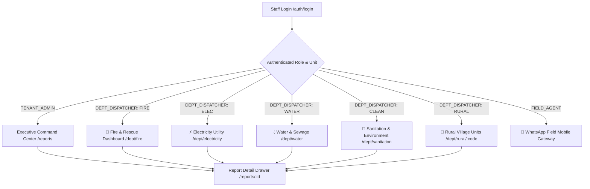

# 6. Dashboard Design & Component Specifications: واصل (Wassel)

## 6.1 Overview and Architecture

The Wassel Dashboard (منصة واصل لإدارة البلاغات) is a staff-facing web application built with **Next.js 14 (App Router)** and **Tailwind CSS**. It serves a comprehensive multi-level municipal hierarchy:

### Organizational Roles & Access Control
1. **Super Admin / Governorate (ديوان المحافظة)**: Cross-city visibility across all centers (Sunbullawein, Mansoura, Mit Ghamr...).
2. **Tenant Admin / City Leadership (رئاسة مجلس المدينة)**: Complete overview of all municipal sectors, SLA performance comparison, citizen satisfaction ratings, and cross-department escalations.
3. **Department Dispatcher / Unit Operator (مشرف غرفة عمليات الوحدة التنفيذية)**: Dedicated, distraction-free dashboard showing ONLY reports belonging to their sector (Fire, Ambulance, Electricity, Water/Sewage, Sanitation, Rural Village Units).
4. **Field Agent / Technician (الفني / السائق الميداني)**: Mobile WhatsApp Field Dispatch interface receiving GPS coordinates, incident photos, and dispatching resolution updates directly from the street.

### Core UX Principles
- **RTL-First (Right-to-Left)**: Native Arabic UI layout (`dir="rtl"`) with Alexandria and Cairo typography.
- **High-Density, Fast-Scan Interface**: Designed for quick keyboard/mouse triage without unnecessary multi-layer modals or deeply nested navigation.
- **Specialized Department Views**: Department operators only see what concerns their duty; Fire does not see pothole reports, Sanitation does not see power outages.
- **Audible Emergency Alerts**: High-urgency incidents (fires, gas leaks, severe electrocution risks) trigger real-time audible chimes and visual pulsing alerts on the relevant department dashboard.
- **Instant Google Maps Routing**: Each report features instant coordinate links (`https://www.google.com/maps/search/?api=1&query=${lat},${lng}`) and routing waypoints.

---

## 6.2 Information Architecture & Multi-Department Navigation



### Route Structure

| Route | Allowed Roles | Description |
|---|---|---|
| `/auth/login` | Public | Email / Mobile OTP login with automatic tenant and department resolution. |
| `/reports` | `TENANT_ADMIN`, `SUPER_ADMIN` | Executive cross-sector inbox: Headline KPIs, comparative SLA charts, comprehensive filter toolbar. |
| `/dept/fire` | `DEPT_DISPATCHER (FIRE)`, `TENANT_ADMIN` | Dedicated Fire & Civil Defense Dashboard: Audible alarms, nearby hydrant maps, fire engine dispatch buttons. |
| `/dept/electricity` | `DEPT_DISPATCHER (ELEC)`, `TENANT_ADMIN` | Electricity Utility Dashboard: Damaged street poles, transformers, live electrocution hazard tracker. |
| `/dept/water` | `DEPT_DISPATCHER (WATER)`, `TENANT_ADMIN` | Water & Sewage Dashboard: Pipe ruptures, suction truck fleet management, water cut tracker. |
| `/dept/sanitation` | `DEPT_DISPATCHER (CLEAN)`, `TENANT_ADMIN` | Sanitation & Environmental Cleanliness: Waste accumulation clusters, heavy machinery tractor routing. |
| `/dept/rural/[code]` | `DEPT_DISPATCHER (RURAL)`, `TENANT_ADMIN` | Rural Local Village Unit Dashboard: Geofenced strictly to village boundaries (Barhamtoush, El-Hagayzah, Tanboul...). |
| `/reports/[id]` | All Staff Roles (Scoped by Dept) | Full report drawer: Citizen photo viewer, status progression form, assignment selector, audit trail. |
| `/settings` | `TENANT_ADMIN`, `SUPER_ADMIN` | Municipal tenant administration: Departments, Categories, Team members, Working hours, Directory. |

---

## 6.3 Screen Specifications & Layouts

### Screen 1: Staff Login (`/auth/login`)

```
+-------------------------------------------------------------+
|                         سيتي كونكت                          |
|             نظام متابعة وإدارة البلاغات البلدية             |
|                                                             |
|  +-------------------------------------------------------+  |
|  | البريد الإلكتروني                                     |  |
|  | [ name@organization.eg                              ] |  |
|  |                                                       |  |
|  | كلمة المرور                                           |  |
|  | [ ••••••••••••••••                                   ] |  |
|  |                                                       |  |
|  | [ تسجيل الدخول                                      ] |  |
|  +-------------------------------------------------------+  |
|                                                             |
|  ملاحظة: الدخول مخصص لموظفي المنظمات ومسؤولي النظام فقط.    |
+-------------------------------------------------------------+
```

#### Behavior & Validation
- **Input Sanitization**: Email is trimmed and lowercased before submission.
- **Generic Error Handling**: If authentication fails, the error message reads: `"بيانات الاعتماد غير صحيحة، يرجى التأكد من البريد الإلكتروني وكلمة المرور"` regardless of whether the email exists.
- **Session Handling**: Receives short-lived access JWT in memory/HTTP-only cookie and rotating refresh token in a strict `SameSite=Lax` HTTP-only cookie.
- **Forced Password Reset**: If `user.mustChangePassword === true`, redirects immediately to a modal forcing a new password before granting dashboard access.

---

### Screen 2: Reports Inbox (`/reports`)

```
+-----------------------------------------------------------------------------------------------------------------+
| سيتي كونكت [اسم المنظمة]                      (3) البلاغات المتأخرة | (2.4 يوم) متوسط الحل | (142) إجمالي البلاغات | [محمد] خروج |
+-----------------------------------------------------------------------------------------------------------------+
| تصفية: [الحالة: الكل v] [الفئة: إنارة v] [المعين: الكل v] [بحث: كود أو هاتف...    ] [إعادة ضبط]     تصدير CSV [ ] |
+-----------------------------------------------------------------------------------------------------------------+
| كود البلاغ | الفئة   | الوصف                          | الموقع       | الصورة  | الحالة       | المعين له | منذ      | إجراءات |
|------------|---------|--------------------------------|--------------|---------|--------------|-----------|----------|---------|
| SBL-K7HN3R | إنارة   | عمود نور مكسور أمام مدرسة ا... | [📍 الخريطة] | [🖼️]   | 🔵 جاري العمل| د. أحمد   | 3 ساعات | [معاينة] |
| SBL-M9PX4T | نظافة   | تراكم قمامة بجوار الموقف العم..| [📍 الخريطة] | [ - ]   | 🔴 جديد      | غير معين  | 5 ساعات | [معاينة] |
| SBL-W2BC8L | طرق     | هبوط أرضي في الشارع الرئيسي   | [📍 الخريطة] | [🖼️]   | 🟠 قيد الفحص | م. سمير   | يومين    | [معاينة] |
| SBL-Q1YZ5K | مياه    | كسر ماسورة مياه عذبة           | [📍 الخريطة] | [🖼️]   | 🟢 تم الحل   | م. سمير   | 4 أيام   | [معاينة] |
+-----------------------------------------------------------------------------------------------------------------+
| الصفحات: [السابق] [1] 2 3 4 [التالي]                                      عرض 1 إلى 20 من أصل 142 بلاغ         |
+-----------------------------------------------------------------------------------------------------------------+
```

#### 1. Top Bar: The 3 V1 KPI Cards
Per the locked v1 scope cuts, analytics are strictly limited to three headline numbers (computed via `/api/v1/analytics/overview`):
1. **إجمالي البلاغات (Total Reports)**: Total count of reports submitted for this tenant to date.
2. **متوسط مدة الحل (Avg Resolution Time)**: Computed as `AVG(resolvedAt - createdAt)` formatted in human-readable Arabic days/hours (e.g., `2.4 يوم`).
3. **البلاغات المتأخرة (Overdue Reports)**: Count of open reports (`NEW`, `IN_REVIEW`, `IN_PROGRESS`) whose age exceeds `tenant.overdueAfterHours` (default: 72 hours). Renders in bold red badge if > 0.

#### 2. Filter Toolbar
- **Status Filter**: Dropdown with options: الكل (All), جديد (New), قيد المراجعة (In Review), جاري العمل (In Progress), تم الحل (Resolved), مرفوض (Rejected).
- **Category Filter**: Dynamically populated from active tenant categories.
- **Search Input**: Debounced (300ms) text search on `trackingCode` or E.164 phone hash.
- **Export CSV Button**: Exports current filtered view to UTF-8 BOM CSV (with Arabic headers).

#### 3. Report Row Items
- **Location Link**: Renders `[📍 فتح في الخريطة]` linking to `https://www.google.com/maps/search/?api=1&query=${lat},${lng}` targeting `_blank`. If coordinates were skipped by citizen, displays `غير محدد`. If coordinates fall outside `tenant.settings.geoBounds`, displays an amber badge: `[⚠️ خارج النطاق]`.
- **Photo Thumbnail**: Displays a 36x36px thumbnail if an attachment exists. Clicking opens an instant photo modal preview using a signed MinIO URL.
- **Relative Date**: Formatted in Arabic relative time (`منذ 3 ساعات`, `منذ يومين`) using `date-fns/locale/ar-EG`.

#### 4. Incident Spike Alert Banner (Scenario 2.1)
When the API detects > 10 reports in the same category within 60 minutes, an alert banner renders above the table:
`[🚨 تنبيه ضغط بلاغات: تم رصد (24) بلاغاً في فئة "مياه" خلال آخر ساعة — احتمال وجود عطل أو كسر رئيسي]`

---

### Screen 3: Report Detail Drawer / Drawer (`/reports/[id]`)

When clicking `[معاينة]` on any table row, a sliding drawer opens from the right side without navigating away from the current table page state:

```
+-------------------------------------------------------------------+
| تفاصيل البلاغ: SBL-K7HN3R                           [X إغلاق]      |
+-------------------------------------------------------------------+
| معلومات عامة:                                                    |
|  * تاريخ الإنشاء: 10 أكتوبر 2026 - 11:30 ص                         |
|  * رقم المواطن: +20 101 **** 89 (مشفر جزئياً)                     |
|  * الفئة: إنارة عامة                                               |
|  * الموقع: السنبلاوين (30.9765, 31.5214) -> [عرض على خرائط Google] |
|                                                                   |
| الوصف المقدم من المواطن:                                          |
| "عمود النور اللي قدام مدرسة النور مطفي من أسبوع والشارع ضلمة كحل" |
|                                                                   |
| الصورة المرفقة:                                                   |
| [===========================]                                     |
| [    صورة العمود المكسور    ]  [تكبير الصورة] [تحميل]             |
| [===========================]                                     |
| [🗑️ حذف الصورة الخاطئة / غير اللائقة (حذف نهائي)]                  |
+-------------------------------------------------------------------+
| تحديث حالة البلاغ:                                                |
| الحالة الحالية: [ 🔵 جاري العمل           v ]                     |
| الموظف المسؤول: [ د. أحمد فؤاد            v ]                     |
|                                                                   |
| الردود السريعة الجاهزة (بنقرة واحدة لتوفير وقت الموظف):           |
| [⚡ تم توجيه الفني للموقع]  [⚡ تم استلام البلاغ وجاري الفحص]      |
| [⚡ تم حل المشكلة وتجربة التشغيل] [⚡ نرجو توضيح العنوان بدقة]     |
|                                                                   |
| 🟢 خانة رسالة المواطن (ستصله عبر الواتساب فوراً):                 |
| [===============================================================] |
| [ ⚠️ تنبيه: هذه الرسالة ستصل للمواطن على هاتفه مباشرة!          ] |
| [ تم توجيه فني الكهرباء للموقع وجاري فحص الكابلات.              ] |
| [===============================================================] |
|                                                                   |
| 🔒 خانة الملاحظات الداخلية (سرية للفريق فقط - لن تظهر للمواطن):   |
| [===============================================================] |
| [ 🔒 ملاحظات خاصة بالفريق الداخلي (لن تصل للواتساب أبداً):       ] |
| [ الكابل يحتاج تبديل 50 متر من المخزن. تم تكليف عم صبحي.       ] |
| [===============================================================] |
|                                                                   |
| [ حفظ التغييرات وإرسال الإشعار ]                                  |
| (⚡ مهلة 15 ثانية للتراجع قبل إرسال الواتساب الفعلي)              |
|                                                                   |
| [⚖️ محو بيانات المواطن بموجب قانون 151 (حذف كامل للخصوصية)]      |
+-------------------------------------------------------------------+
| سجل الأحداث والتدقيق (Chronological Audit Trail):                 |
|  - 10 أكتوبر 11:30 ص: أنشئ البلاغ بواسطة المواطن (جديد)            |
|  - 10 أكتوبر 01:15 م: تم التعيين لـ د. أحمد بواسطة محمد            |
|  - 11 أكتوبر 09:00 ص: تغيرت الحالة إلى (جاري العمل)               |
+-------------------------------------------------------------------+
```

#### Behavior & Form Rules
- **Radical Visual Split (Internal Notes vs Citizen Message)**:
  - **Citizen Message Field**: Distinct green container styling (`bg-emerald-50/50 border-emerald-300 focus:border-emerald-500`) with a visible WhatsApp icon and label: `"رسالة المواطن (ستصله عبر الواتساب)"`.
  - **Internal Team Note Field**: Distinct amber/zinc container styling (`bg-amber-50/50 border-amber-300 focus:border-amber-500`) with a visible lock icon 🔒 and bold label: `"ملاحظة داخلية (سرية للفريق - لا يراها المواطن مطلقاً)"`.
  - Prevents staff internal comments (e.g. complaints about a citizen or inventory notes) from ever being accidentally dispatched to the citizen.
- **15-Second Undo Grace Window (Accidental Status Update Safeguard)**:
  - When staff updates status (e.g. accidentally clicking "RESOLVED"), the database updates optimistically, but the WhatsApp Outbox dispatch job is delayed in BullMQ by 15 seconds (`delay: 15000`).
  - A sticky toast notification appears at top of dashboard:
    `"✅ تم تحديث الحالة إلى (تم الحل). سيتم إرسال إشعار الواتساب للمواطن خلال 15 ثانية... [تراجع الآن ↩️]"`
  - Clicking `[تراجع الآن]` cancels the queued BullMQ outbox job immediately and rolls back the status in Postgres, preventing erroneous messages from reaching citizens.
- **1-Click Inappropriate Media Purge (`[🗑️ حذف الصورة الخاطئة]`):**
  - If a citizen accidentally uploads a personal selfie, private document, or inappropriate picture, staff clicks this button.
  - Deletes the object from MinIO, sets `attachmentUrl = null`, logs an `AuditEvent` (`MEDIA_PURGED_BY_STAFF`), and preserves the ticket description without exposing the photo to technicians.
- **Quick Canned Responses**: Clicking any canned response pill populates the citizen message textarea instantly, saving the staff 2–3 minutes per ticket.
- **Image Lightbox & Full-Resolution Inspection**: Clicking `[تكبير الصورة]` opens a responsive pan-zoom Lightbox modal with a direct link to open the full-resolution asset via signed URL in a new tab.
- **Optimistic Locking Guard (Scenario 3.1)**: When submitting status/assignment changes, the request payload sends `version`. If another agent modified the report concurrently, a 409 Conflict toast appears: `"تم تعديل البلاغ بواسطة موظف آخر، يرجى تحديث الصفحة"`.
- **Mandatory Rejection Message**: If status is changed to `REJECTED`, the form requires `citizenMessage` (min 10 chars). The submit button is disabled until filled.
- **Two-Step PDPL Erasure Confirmation**: Clicking `[محو بيانات المواطن بموجب قانون 151]` requires the admin to enter their password AND re-type the ticket tracking code (`SBL-K7HN3R`) to prevent accidental wipe of active evidence.
- **Session Idle Auto-Lock**: A client-side activity listener monitors mouse/keyboard interaction. After 30 minutes of inactivity, the screen blurs and prompts for user PIN/password to unlock, protecting unattended shared workstations in municipal offices.

---

### Screen 4: Mobile Adaptive Feed Layout (`< 768px`)

On mobile screens (e.g. receptionist or doctor inspecting on a smartphone), the dense 9-column table automatically transforms into a vertical card feed (`block md:hidden`), eliminating horizontal scrolling completely:

```
+-------------------------------------------------------------+
| واصل [عيادات النور]                 (3) متأخرة | [محمد] خروج |
+-------------------------------------------------------------+
| [🔍 بحث...] [تصفية: الكل v]                                 |
+-------------------------------------------------------------+
| SBL-K7HN3R  |  إنارة عامة                         منذ 3 ساعات |
| 🔵 جاري العمل                                 المعين: د. أحمد |
| عمود نور مكسور أمام مدرسة النور...                            |
| [📍 الخريطة]  [🖼️ معاينة الصورة]                    [معاينة >] |
+-------------------------------------------------------------+
| SBL-M9PX4T  |  نظافة                               منذ 5 ساعات |
| 🔴 جديد                                     المعين: غير معين |
| تراكم قمامة بجوار الموقف العمومي...                          |
| [📍 الخريطة]                                        [معاينة >] |
+-------------------------------------------------------------+
| الصفحات: [السابق] [1] 2 3 [التالي]                           |
+-------------------------------------------------------------+
```

---

## 6.4 Component Specification (shadcn / Tailwind Patterns)

To maintain the strict 120-160 hour solo budget, all components follow standard **shadcn/ui** patterns using pure Tailwind CSS:

### 1. `StatusBadge` Component
```tsx
interface StatusBadgeProps {
  status: 'NEW' | 'IN_REVIEW' | 'IN_PROGRESS' | 'RESOLVED' | 'REJECTED';
}

const statusConfig = {
  NEW: { label: 'جديد', bg: 'bg-red-50 text-red-700 border-red-200', dot: 'bg-red-500' },
  IN_REVIEW: { label: 'قيد المراجعة', bg: 'bg-amber-50 text-amber-700 border-amber-200', dot: 'bg-amber-500' },
  IN_PROGRESS: { label: 'جاري العمل', bg: 'bg-blue-50 text-blue-700 border-blue-200', dot: 'bg-blue-500' },
  RESOLVED: { label: 'تم الحل', bg: 'bg-emerald-50 text-emerald-700 border-emerald-200', dot: 'bg-emerald-500' },
  REJECTED: { label: 'مرفوض', bg: 'bg-zinc-100 text-zinc-700 border-zinc-200', dot: 'bg-zinc-500' },
};

export function StatusBadge({ status }: StatusBadgeProps) {
  const config = statusConfig[status];
  return (
    <span className={`inline-flex items-center gap-1.5 px-2.5 py-0.5 rounded-full text-xs font-medium border ${config.bg}`}>
      <span className={`w-1.5 h-1.5 rounded-full ${config.dot}`} />
      {config.label}
    </span>
  );
}
```

### 2. `KPICard` Component
```tsx
interface KPICardProps {
  title: string;
  value: string | number;
  subtitle?: string;
  isAlert?: boolean;
}

export function KPICard({ title, value, subtitle, isAlert }: KPICardProps) {
  return (
    <div className={`p-4 rounded-xl border bg-white shadow-sm flex flex-col justify-between ${
      isAlert ? 'border-red-200 bg-red-50/30' : 'border-zinc-200'
    }`}>
      <span className="text-sm font-medium text-zinc-500">{title}</span>
      <div className="mt-2 flex items-baseline gap-2">
        <span className={`text-2xl font-bold tracking-tight ${isAlert ? 'text-red-600' : 'text-zinc-900'}`}>
          {value}
        </span>
        {subtitle && <span className="text-xs text-zinc-400">{subtitle}</span>}
      </div>
    </div>
  );
}
```

### 3. `MapExternalLink` Component
```tsx
interface MapExternalLinkProps {
  latitude: number | null;
  longitude: number | null;
}

export function MapExternalLink({ latitude, longitude }: MapExternalLinkProps) {
  if (!latitude || !longitude) {
    return <span className="text-xs text-zinc-400">غير محدد</span>;
  }

  const mapsUrl = `https://www.google.com/maps/search/?api=1&query=${latitude},${longitude}`;

  return (
    <a
      href={mapsUrl}
      target="_blank"
      rel="noopener noreferrer"
      className="inline-flex items-center gap-1 text-xs text-blue-600 hover:text-blue-800 hover:underline font-medium"
      title={`إحداثيات: ${latitude}, ${longitude}`}
    >
      <span>📍</span>
      <span>عرض الخريطة</span>
    </a>
  );
}
```

---

## 6.5 Frontend State & Data Fetching Architecture

- **SWR / TanStack Query**: Client-side data fetching for the reports table and KPI bar with:
  - 30-second background polling for new reports.
  - Automatic revalidation on drawer close.
  - Optimistic mutations for status changes.
- **Session Context**: Auth token stored in memory via a custom `useAuth()` hook. Refresh token is transparently cycled via Axios/Fetch interceptor against `/api/v1/auth/refresh`.

---

## 6.6 Accessibility & Localization (RTL Standards)

1. **HTML Layout Attributes**: `<html dir="rtl" lang="ar">` with CSS rules adapting logical flex alignments (`ms-auto`, `me-2`, `space-x-reverse`).
2. **Typography**: Google Font `Cairo` or `Alexandria` with Arabic fallback stack:
   `font-family: 'Cairo', system-ui, -apple-system, BlinkMacSystemFont, 'Segoe UI', Roboto, sans-serif;`
3. **Numerals**: UI renders standard Western Arabic numerals (0, 1, 2, 3...) for unambiguous code reading and timestamp consistency.
