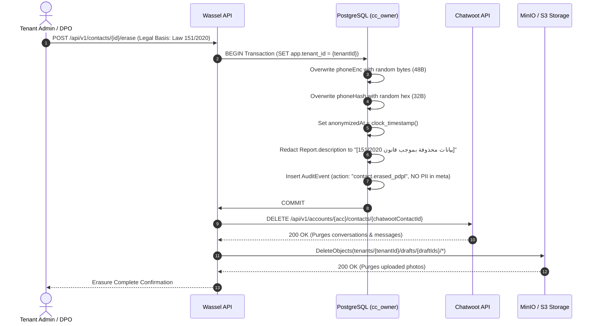
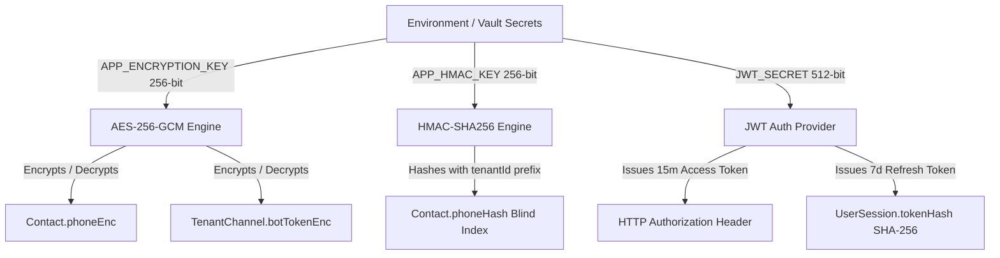

# 7. Security, Privacy & Compliance (Egypt PDPL Law 151/2020)

## 7.1 Regulatory Compliance: Egyptian PDPL (قانون ١٥١ لسنة ٢٠٢٠)

The Egyptian Personal Data Protection Law (Law 151/2020) governs how citizen personal data must be gathered, stored, processed, and erased. Wassel (منصة واصل) is designed from day one to operate strictly within this framework.

### Legal Foundations & Processing Grounds

| Legal Requirement (Law 151/2020) | Platform Implementation | Verification / Evidence |
|---|---|---|
| **Explicit Consent (الموافقة الصريحة)** | Recorded at first contact during WhatsApp interaction (`Flow 1`). Citizen is informed that their phone and location are processed solely for resolving municipal/organizational reports. | `Contact.consentAt` timestamp and `Contact.consentVersion` stored in database. |
| **Purpose Limitation (تحديد الغرض)** | Data collected (phone number, coordinates, issue photos) is used exclusively for report resolution and direct status notifications. Never used for marketing or commercial profiling. | Enforced at application layer; tenant staff have no bulk export access to unmasked citizen phone numbers. |
| **Data Minimization (الحد الأدنى للبيانات)** | The citizen is never asked for national ID (الرقم القومي), full legal name, or home address unless voluntarily supplied in the description. Phone numbers are stored encrypted. | `Contact.phoneEnc` (AES-256-GCM) + `Contact.phoneHash` (blind index). |
| **Right to Erasure (حق المحو والنسيان)** | Citizen can request complete erasure of their personal identity and historical contact records. | Automated erasure procedure in `constraints-and-roles.sql` and `/api/v1/contacts/:id/erase`. |

---

## 7.2 Right to Erasure Execution Runbook

When a citizen exercises their legal right to be forgotten under Law 151/2020, the system performs an atomic multi-system scrub:



### Complete Erase Checklist:
1. **Database Identity Anonymization**: `phoneEnc` and `phoneHash` overwritten with random cryptographic noise so that historical reports can never be linked back to the physical phone number or correlated across tables.
2. **Free-Text Redaction**: Any identifying details (names, landmarks, phone mentions) in `Report.description` and `ReportEvent.note` are replaced with a standard legal redaction disclaimer.
3. **Chatwoot Purge**: The Chatwoot contact and its entire inbound/outbound WhatsApp message thread are permanently deleted via Chatwoot REST API.
4. **Object Storage Purge**: All image files tied to the citizen's drafts are permanently deleted from the private S3/MinIO bucket.
5. **Backups Policy**: Database backups are encrypted at rest (AES-256) and subject to a strict **30-day rolling retention cycle**. Erased records naturally age out of all backup snapshots within 30 days, satisfying PDPL compliance guidelines.

---

## 7.3 Threat Modeling & Attack Defenses

We evaluated the top threat vectors relevant to a WhatsApp-first civic SaaS architecture:

### 1. WhatsApp Webhook Spoofing / Replay Attacks
- **Risk**: An attacker sends forged webhook HTTP POST requests to `/api/v1/webhooks/chatwoot` to impersonate citizens or inject malicious reports.
- **Defense**:
  - Every tenant channel has an unguessable 32-character random webhook secret in its URL path (`/api/v1/webhooks/chatwoot/:channelId?token=...`).
  - The incoming token is hashed with SHA-256 and compared in constant time (`crypto.timingSafeEqual`) against `TenantChannel.webhookSecretHash`.
  - Inbound payload `message.id` is immediately inserted into `InboxMessage` with `@@unique([tenantId, provider, providerMessageId])`. Replayed webhooks fail the unique constraint and return `200 OK` immediately without processing.

### 2. Cross-Tenant Data Leaks
- **Risk**: A compromised agent token or SQL flaw allows Tenant A (e.g. Clinic in Mansoura) to read reports or citizen contacts from Tenant B (Sunbullawein).
- **Defense**:
  - **Option A Application Layer Enclosure**: All data access is funneled through a strict `TenantRepository` where `tenantId` is extracted solely from the verified JWT payload—never from URL parameters or request bodies.
  - **Composite Keys & Foreign Keys**: All child tables enforce `@@unique([tenantId, id])` and composite foreign keys (`[tenantId, parentId] references [tenantId, id]`), making it structurally impossible for a record to point to a different tenant's parent.
  - **Automated CI Gate**: A mandatory E2E test suite asserts that tenant A's token attempting any CRUD operation on tenant B's resources receives a strict `404 Not Found`.

### 3. Citizen Phone Number Correlation & Breach Defense
- **Risk**: A database leak exposes the phone numbers of citizens reporting sensitive complaints.
- **Defense**:
  - **Envelope Encryption**: `Contact.phoneEnc` is encrypted with AES-256-GCM. The encryption key is injected via environment variables and never stored in the database.
  - **Tenant-Scoped Blind Index**: To enable fast lookup and rate limiting without decrypting numbers, `Contact.phoneHash` uses:
    $$\text{HMAC-SHA256}(\text{HMAC\_SECRET}, \text{tenantId} \parallel \text{':'} \parallel \text{E.164\_phone})$$
    Because `tenantId` is included in the hash input, the same citizen produces completely different hashes in different tenants. A leaked database dump cannot be used to track a citizen across multiple organizations.

### 4. Tracking Code Brute-Forcing & Enumeration
- **Risk**: An attacker iterates through tracking codes (`SBL-XXXXXX`) to monitor complaint details.
- **Defense**:
  - **Entropy**: Codes use a 28-character alphabet (excluding easily confused characters `0, 1, I, L, O`) over 6 characters:
    $$28^6 = 481,890,304 \text{ possible combinations per tenant}$$
  - **Ownership Scoping**: When a citizen requests status via WhatsApp (`Flow 7`), the API checks `Report.contactId === sender.contactId`. If the code exists but belongs to someone else, the bot returns the identical generic error `"مش لاقيين بلاغ بالرقم ده"` (preventing code enumeration).
  - **Rate Limiting**: Lookups are rate-limited to 5 attempts per minute per conversation via Redis.

### 5. Employee Email Enumeration
- **Risk**: An attacker tries random email addresses on `/api/v1/auth/login` or tenant invitation endpoints to harvest organizational staff emails.
- **Defense**:
  - Login failures return a generic error: `"Invalid credentials"`.
  - User invitations/registrations return a generic response (`"Unable to complete registration"`) even if the email already exists in the global `User.email` unique constraint.

---

## 7.4 Cryptographic Architecture & Key Management



### Key Rotation Procedure
1. **Data Encryption Key (DEK)**:
   - When rotating `APP_ENCRYPTION_KEY`, increment `keyVersion` to 2.
   - The application supports reading keys from an active keyring: decrypts with the record's `keyVersion`, re-encrypts with the latest key, and updates `keyVersion`.
2. **Blind Index Key**:
   - As documented in `schema.prisma`, `@@unique([tenantId, phoneHash])` is preserved.
   - Rotation uses an online dual-query migration: during rotation, searches compute both old and new hashes while a background worker updates `phoneHash` rows in batches.

---

## 7.5 Access Control Matrix (RBAC)

| Resource / Endpoint | `AGENT` | `TENANT_ADMIN` | `PLATFORM_ADMIN` |
|---|:---:|:---:|:---:|
| Read Reports & Attachments | ✅ (own tenant) | ✅ (own tenant) | ❌ |
| Update Report Status & Assign | ✅ (own tenant) | ✅ (own tenant) | ❌ |
| Add Internal Notes | ✅ (own tenant) | ✅ (own tenant) | ❌ |
| View 3 Headline KPIs | ✅ (own tenant) | ✅ (own tenant) | ❌ |
| Manage Categories & Working Hours | ❌ | ✅ (own tenant) | ❌ |
| Invite / Deactivate Tenant Agents | ❌ | ✅ (own tenant) | ❌ |
| Trigger PDPL Citizen Erasure | ❌ | ✅ (own tenant) | ✅ |
| Onboard New Tenants & Channels | ❌ | ❌ | ✅ (platform-wide) |
| Activate Tenant (RLS Gate Check) | ❌ | ❌ | ✅ (platform-wide) |
| Direct DB Access (`cc_owner`) | ❌ | ❌ | ✅ (emergency CLI only) |

---

## 7.6 Append-Only Immutability & Audit Trail

To ensure non-repudiation and prevent internal tampering with civic reports:
1. **`ReportEvent` Table**:
   - Records every transition (`CREATED`, `STATUS_CHANGED`, `ASSIGNED`, `NOTE_ADDED`).
   - Protected by PostgreSQL trigger `report_event_append_only` which throws an immediate exception on any `UPDATE` or `DELETE` attempt.
   - Database runtime role `cc_app` is only granted `SELECT, INSERT`—never `UPDATE` or `DELETE`.
2. **`AuditEvent` Table**:
   - Records all administrative and security actions (`user.login`, `user.created`, `tenant.activated`, `contact.erased_pdpl`).
   - Protected by PostgreSQL trigger `audit_event_append_only`.
   - Never contains citizen PII or cleartext passwords in the `meta` JSON column.

---

## 7.7 Advanced Hardening for High-Stress Threat Scenarios

### 1. Keyring Array & Online Batch Re-Encryption (Scenario 2: Key Leak)
If `APP_ENCRYPTION_KEY` is ever compromised, the system avoids catastrophic data loss by supporting a versioned Keyring:
```typescript
export class EncryptionService {
  private readonly keyring: Record<number, Buffer> = {
    1: Buffer.from(process.env.APP_ENCRYPTION_KEY_V1!, 'hex'), // Old key (decrypt-only)
    2: Buffer.from(process.env.APP_ENCRYPTION_KEY_V2!, 'hex'), // Current key (encrypt & decrypt)
  };

  decrypt(encryptedData: Buffer, keyVersion: number): string {
    const key = this.keyring[keyVersion];
    if (!key) throw new Error(`Missing decryption key for version ${keyVersion}`);
    // Decrypt AES-256-GCM payload
    return decipher(encryptedData, key);
  }
}
```
A zero-downtime maintenance script (`scripts/rotate-keys.ts`) iterates across `Contact` in batches of 100, decrypts with version 1, re-encrypts with version 2, and bumps `keyVersion` to 2.

### 2. Rogue Admin Sabotage Defenses (Scenario 3)
To prevent a disgruntled employee from sabotaging citizen trust:
1. **Status Transition Rate Limiting**: Max 15 status mutations per user per minute via Redis token bucket. Exceeding this freezes the user session.
2. **Rejection Content Sanitizer**: Rejection messages (`citizenMessage`) are scanned against a regex profanity filter and prohibited terms. Abusive submissions are rejected with HTTP 422 and logged as security incidents.
3. **Emergency Platform Kill-Switch**: The platform administrator has an immediate endpoint (`POST /api/v1/platform/tenants/:id/sessions/revoke-all`) that instantly revokes all refresh tokens and invalidates all staff JWTs for that organization.

### 3. Malicious Media Sanitization & De-Weaponization (Scenario 6)
To neutralize polyglot files, buffer overflow exploits, and hidden EXIF payloads:
1. **Magic Bytes Inspection**: The worker inspects the initial 512 bytes via `file-type` to verify file headers (`image/jpeg`, `image/png`, `audio/ogg`, `audio/mp4`). Never trust user-provided extensions or MIME types.
2. **Pixel Re-Encoding & EXIF Stripping**: Images are loaded into `sharp`, all EXIF and metadata blocks are completely stripped, and pixel data is re-encoded into a fresh WebP format. No raw binary streams from citizens are ever served to staff.

---

## 7.8 Regulatory Inquiry & Municipal Compliance Package (Scenario 7)

To defend against political friction or municipal authority inquiries:
1. **Automated Compliance Dossier**:
   Endpoint `GET /api/v1/tenants/compliance-dossier` exports a signed PDF/JSON compliance certificate proving:
   - Zero National ID or biometric collection.
   - AES-256-GCM encryption at rest.
   - Complete Law 151/2020 right-to-erasure support with cryptographic receipts.
2. **Municipal Observer Role (`MUNICIPAL_OBSERVER`)**:
   Provides city council representatives with a dedicated read-only dashboard showing aggregate complaint trends and public issue maps without exposing private citizen phone hashes or internal staff notes, turning political friction into collaborative civic oversight.
