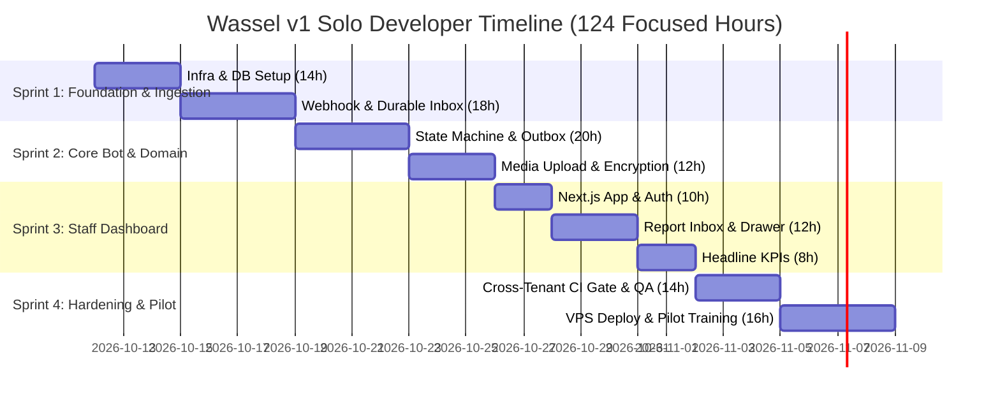

# 10. Project Delivery Plan & Solo Developer Sprints: واصل (Wassel)

## 10.1 Delivery Methodology & Time Allocation

To deliver Wassel (واصل) v1 within the target window of **120–160 developer hours**, the project is partitioned into **four logical sprints (totaling 124 focused hours)**. 

> **Realistic Scheduling Note for Solo Part-Time Execution:**  
> If dedicated full-time (31h/week), this spans **4 calendar weeks**.  
> In a part-time capacity (15–20h/week realistic developer bandwidth), this spans **7 to 8 calendar weeks**.

### Sprints Overview

| Sprint | Focus Area | Planned Hours | Deliverable |
|---|---|:---:|---|
| **Sprint 1** | Infrastructure, Database & Ingestion Engine | 32h | Running Docker Compose, Postgres schemas, Chatwoot webhook receiver with deduplication. |
| **Sprint 2** | Bot State Machine, Media Pipeline & Outbox | 32h | Working WhatsApp bot handling flows 1-7, photo uploads to MinIO, and transactional notifications. |
| **Sprint 3** | Staff Dashboard & Tenant Management | 30h | Responsive Next.js dashboard with live report list, detail drawer, status updates, and 3 headline KPIs. |
| **Sprint 4** | Security Hardening, CI Gates, Deployment & Pilot Launch | 30h | Production deployment on 8 GB VPS, green cross-tenant CI gate, staff onboarding in Sunbullawein. |
| **Total** | | **124h** | **Execution-ready production MVP** (Well within the 120-160h limit). |

---

## 10.2 Detailed Sprint Breakdown

### Sprint 1: Foundation & Webhook Engine (32 Hours)

* **Goal**: Establish the local and containerized development environment, migrate database schemas, and achieve reliable, idempotent webhook ingestion from Chatwoot.
* **Tasks & Hour Estimates**:
  1. **Infrastructure Bootstrap (6h)**: Configure local `docker-compose.yml` with Postgres 16, Redis 7, MinIO, and Chatwoot.
  2. **Database Provisioning (8h)**: Run `schema.prisma` migrations, apply `constraints-and-roles.sql` (Section A & B), test non-owner `cc_app` role connection and `cc_shadow` migrations.
  3. **NestJS Modular Core (6h)**: Initialize NestJS monolith with Fastify adapter, configure ConfigModule, Zod validation pipe, and Pino structured logger.
  4. **Chatwoot Ingestion Webhook (12h)**:
     - Implement `/api/v1/webhooks/chatwoot/:channelSecret`.
     - Implement timing-safe webhook secret verification.
     - Implement atomic deduplication via `InboxMessage` table (`@@unique([tenantId, provider, providerMessageId])`).
     - Push raw inbound message to BullMQ queue `incoming-messages`.

---

### Sprint 2: Conversational Bot Engine & Media (32 Hours)

* **Goal**: Enable citizens to submit reports, skip optional steps, upload photos, receive tracking codes, and query status updates via WhatsApp with full human-error tolerance.
* **Tasks & Hour Estimates**:
  1. **Pure State Transition Engine & Error Guards (10h)**:
     - Implement pure function `transition(state, message, draftContext)`.
     - Implement Egyptian Arabic copy templates for flows 1 through 7 + Flow 8 call rejection.
     - Support cancellation (`"إلغاء"`), back navigation (`"رجوع"`), skip flags (`"تخطي"`), and dispute reopen (`"اعتراض"`).
     - Implement human-error guards: emoji stripper (min 2 words/8 chars), fuzzy tracking code cleaner, voice note prompt redirect in numeric menus.
  2. **BullMQ Message Worker & Debouncer (6h)**:
     - Worker picks message, acquires Redis lock on `conversationId`, executes state transition, and updates `ReportDraft`.
     - 1500ms debounce window grouping multi-photo bursts into single draft attachment array.
     - Redis duplicate detector checking active reports in same category within 30 minutes.
  3. **Media Pipeline & S3 Integration (6h)**:
     - Worker downloads photos from Meta/Chatwoot media endpoint using bot token.
     - Stream validated image buffer directly to MinIO bucket (`tenants/{tenantId}/drafts/{draftId}/{id}`).
     - Store metadata and SHA-256 hash in `Attachment` table.
  4. **Transactional Outbox & Notifications (10h)**:
     - Implement `Notification` table insertion within the report creation transaction.
     - Implement outbox poller worker using `SELECT ... FOR UPDATE SKIP LOCKED`.
     - Support 15-second delayed dispatch for status update notifications (enabling dashboard undo window).
     - Dispatch outbound messages via Chatwoot Messages REST API.

---

### Sprint 3: Staff Dashboard & Triage Interface (30 Hours)

* **Goal**: Deliver a high-density, RTL-first web application for staff in Sunbullawein to triage, inspect, and resolve incoming reports with operator error-proofing.
* **Tasks & Hour Estimates**:
  1. **Next.js 14 App Router Setup & Idle Watchdog (6h)**:
     - Setup Next.js with Tailwind CSS, RTL layout (`dir="rtl"`), and Cairo font.
     - Implement `/auth/login` with JWT authentication and generic error handling.
     - Implement `useAuth` hook and Axios interceptor for refresh token rotation.
     - Add 30-minute client-side inactivity lock for unattended shared terminals.
  2. **Reports Inbox & Filter Toolbar (10h)**:
     - Implement `/reports` data table with status badges, category pills, and relative timestamps.
     - Add status filter, category filter, and debounced text search (with fuzzy tracking code tolerance).
     - Implement `MapExternalLink` pointing directly to Google Maps coordinates.
  3. **Report Detail Slide-Over Drawer & Human-Proofing (8h)**:
     - Radical visual split: Amber lock 🔒 for internal notes vs Emerald 🟢 with WhatsApp icon for citizen messages.
     - 15-second Undo grace window toast banner (`POST /reports/:id/undo-status`).
     - 1-click `[🗑️ مسح المرفق الخاطئ]` button to purge accidental selfies/documents from MinIO.
     - Optimistic locking guard (`409 Conflict`) on concurrent report edits.
     - Mandatory citizen rejection message when status is set to `REJECTED`.
  4. **Headline KPIs & CSV Export (6h)**:
     - Render the 3 headline KPI cards at top of `/reports`: Total Reports, Avg Resolution Time, Overdue Reports (>72h).
     - Implement client-side UTF-8 BOM CSV export for current filtered table rows.

---

### Sprint 4: Hardening, CI Gates, Deployment & Pilot Launch (30 Hours)

* **Goal**: Lock down multi-tenant boundaries, deploy to the production VPS, and onboard the pilot staff in Sunbullawein.
* **Tasks & Hour Estimates**:
  1. **Cross-Tenant Isolation CI Gate (8h)**:
     - Implement automated E2E test suite (`test/e2e/cross-tenant-isolation.spec.ts`).
     - Verify tenant A receives strict 404s when attempting to access tenant B's reports, categories, or audit logs.
  2. **Security & Trigger Verification (6h)**:
     - Verify `ReportEvent` and `AuditEvent` triggers reject direct `UPDATE` and `DELETE` commands under `cc_app`.
     - Test PDPL citizen erasure script and verify contact anonymization.
  3. **Production VPS Provisioning (8h)**:
     - Provision 8 GB RAM VPS, setup 4 GB swapfile, configure UFW firewall.
     - Configure Caddy with automatic TLS certificates.
     - Deploy `docker-compose.prod.yml` and seed initial Sunbullawein tenant.
     - Setup nightly backup cron script (`scripts/backup.sh`).
  4. **Staff Onboarding & Field Verification (8h)**:
     - Execute 10-minute end-to-end WhatsApp smoke test.
     - Conduct a 60-minute training session for Mohamed (receptionist) and Dr. Hassan (admin).
     - Hand over initial WhatsApp QR code flyer.

---

## 10.3 Solo Developer Rules & Time Guards

To prevent schedule slip:
1. **No Framework Hopping**: Do not experiment with new libraries mid-sprint. Stick strictly to NestJS, Next.js, Tailwind, and Prisma.
2. **Strict Scope Discipline**: Any feature not in the approved v1 specification (e.g. interactive WhatsApp buttons, interactive map layers, voice-to-text AI) is rejected and tagged for `v1.1`.
3. **Daily Timebox**: Maximum 6 hours of active coding per day; if a bug takes more than 2 hours to debug, simplify the architectural approach.
