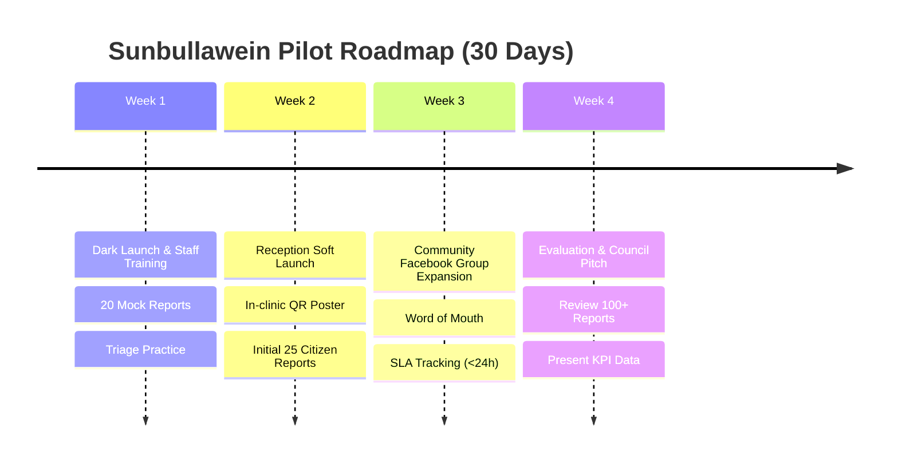

# 11. Pilot Rollout & Field Validation (السنبلاوين - Sunbullawein)

## 11.1 Geographic & Operational Context

The initial proof-of-concept for Wassel (واصل) launches in **مدينة السنبلاوين (Sunbullawein)**, a prominent agricultural and commercial center in the Dakahlia Governorate with an urban population of ~120,000 residents and over 300,000 in surrounding rural villages.

### Why Sunbullawein as First City?
1. **High WhatsApp Saturation**: Almost every adult resident uses WhatsApp daily for family, commerce, and news groups, while formal digital literacy remains moderate.
2. **Acute Communication Friction**: Local complaints (broken streetlights, sewage overflows, clinic administrative issues) currently rely on physical visits to offices or disorganized Facebook community groups.
3. **Manageable Geographic Footprint**: Clear central hub with accessible local organizations willing to act as progressive early adopters.

---

## 11.2 The Pilot Partner: Private Clinic / Medical Center

To ensure immediate operational feedback without getting blocked by municipal government bureaucracy in v1, the primary pilot partner is:
- **Partner**: A multi-specialty private clinic / medical center in central Sunbullawein (Persona: Dr. Hassan, Owner; Mohamed, Receptionist).
- **Tenant Configuration**:
  - `slug`: `sunbullawein-alnoor-clinic`
  - `name`: `مجمع عيادات النور التخصصي - السنبلاوين`
  - `trackingPrefix`: `SBL`
  - `categories`:
    1. `خدمات واستقبال` (Administrative & Reception)
    2. `حجز ومواعيد` (Appointments & Booking)
    3. `نظافة ومرافق` (Hygiene & Facility Complaints)
    4. `شكاوى أطباء` (Medical Staff Feedback)
    5. `شكاوى عامة` (General Feedback)

---

## 11.3 4-Week Rollout Phasing



### Phase 1: Internal Dark Launch (Days 1–7)
- **Goal**: Zero external exposure; verify end-to-end reliability under controlled conditions.
- **Actions**:
  - Verify Meta Cloud API WhatsApp Business Number with tenant branding (`واصل - عيادات النور`).
  - Clinic staff and developer submit 20 synthetic reports simulating:
    - Missing photos (`"تخطي"`).
    - Unclear locations.
    - Status updates (`IN_PROGRESS` $\rightarrow$ `RESOLVED`).
    - Explicit rejection with citizen message.
  - Conduct a 45-minute training session for Mohamed on the Next.js dashboard.

### Phase 2: Soft Public Launch in Clinic (Days 8–14)
- **Goal**: Collect real patient feedback within the physical clinic premises.
- **Actions**:
  - Display printed A4 standee posters at the clinic reception desk and waiting rooms:
    ```
    ┌────────────────────────────────────────────────────────┐
    │              رأيك وبلاغك يهمنا 🏙️                      │
    │         خدمة متابعة البلاغات والاقتراحات               │
    │                                                        │
    │      امسح الكود بكاميرا الموبايل وابعت رسالة واتساب:   │
    │                   [ QR CODE ]                          │
    │               أو على رقم: 010XXXXXXXX                  │
    │                                                        │
    │      * بدون تحميل برامج  * متابعة لحظية بالرقم السري   │
    └────────────────────────────────────────────────────────┘
    ```
  - Receptionist hands small card (business card size) to patients experiencing delays or issues.
  - Monitor first 25 real citizen submissions.

### Phase 3: Community Expansion (Days 15–21)
- **Goal**: Test scalability and outdoor reporting.
- **Actions**:
  - Publish a post in the local Facebook community group (*"شباب السنبلاوين"* / *"أخبار السنبلاوين"*) announcing the WhatsApp service.
  - Expand categories to include environmental and public access issues immediately surrounding the clinic perimeter.
  - Target: 50–75 total reports.

### Phase 4: Pilot Review & Council Pitch Preparation (Days 22–30)
- **Goal**: Extract validated data to demonstrate ROI to paying clinics and the municipal council.
- **Actions**:
  - Pull export CSV and verify the 3 headline KPIs:
    - Total reports handled.
    - Average resolution time (target: < 24 hours).
    - Overdue reports (target: 0).
  - Interview Dr. Hassan and Mohamed on time saved and customer satisfaction.
  - Package data into a 4-slide executive presentation for the Sunbullawein City Council (مجلس مدينة السنبلاوين).

---

## 11.4 Staff Training Cheat Sheet (1 Page for Receptionist)

```markdown
# دليل استخدام نظام سيتي كونكت (لموظف الاستقبال)

1. تسجيل الدخول:
   - افتح المتصفح على رابط: https://dashboard.cityconnect.eg
   - ادخل إيميلك وكلمة المرور الخاصة بك.

2. استلام البلاغ:
   - أي رسالة يبعتها المواطن على الواتساب بتظهر في الشاشة تلقائياً بعلامة (🔴 جديد).
   - اضغط على زر [معاينة] لقراءة تفاصيل المشكلة ورؤية الصورة وموقع الخريطة.

3. تحويل الحالة والرد على المواطن:
   - اختار الحالة: (🔵 جاري العمل) لما تبدأ تتعامل مع البلاغ.
   - اكتب رسالة بسيطة في خانة "رسالة للمواطن" (مثال: "تم إبلاغ دكتور العظام وجاري فحص الموعد").
   - اضغط [حفظ]: النظام هيبعت رسالة واتساب تلقائية للمواطن فوراً!

4. إنهاء البلاغ:
   - لما المشكلة تتحل، اختار (🟢 تم الحل) واكتب كلمة شكر للمواطن.
   - لو البلاغ غير صحيح، اختار (مرفوض) ولازم تكتب سبب الرفض عشان المواطن يفهم.
```

---

## 11.5 Pilot Validation Gates & Success Metrics

Before declaring the MVP successful and commencing multi-tenant commercialization, the pilot must meet these quantifiable criteria:

| Metric | Target | Verification Method |
|---|:---:|---|
| **Completion Rate** | $\ge 70\%$ | Ratio of submitted `Report` records to created `ReportDraft` records. |
| **Response Time SLA** | $< 24\text{ hours}$ | Dashboard Headline KPI: Average time from `NEW` to `IN_PROGRESS`. |
| **Zero Message Loss** | $100\%$ | $0$ dropped inbound messages in `InboxMessage` (verified against Chatwoot logs). |
| **Citizen Satisfaction** | $\ge 4.0 / 5$ | Random sample survey of 20 citizens who used tracking codes. |
| **Staff Usability** | $< 5\text{ mins/day}$ | Receptionist requires less than 5 minutes training per day to manage all incoming reports. |
