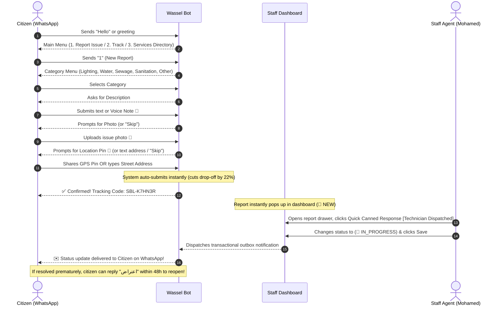
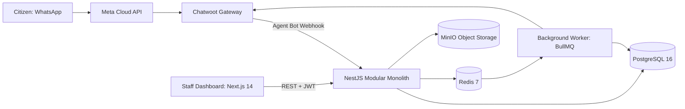

# Wassel (واصل) — Executive Master Plan
## The Comprehensive Product, Technical & Operational Blueprint for Partners & Stakeholders

> **Brand Tagline:** *"Your voice connects, your issue gets resolved"* (صوتك واصل.. وبلاغك محلول)  
> **Version:** v1.0 (MVP)  
> **Proof-of-Concept Hub:** Sunbullawein City (السنبلاوين), Dakahlia Governorate, Egypt  
> **Date:** October 2026

---

## 1. Executive Summary

**Wassel (واصل)** is a lightweight, WhatsApp-first, multi-tenant SaaS layer engineered for municipal civic engagement and organizational service management in Egyptian cities and service institutions (clinics, schools, utility contractors, and municipal district councils).

The platform bridges the single largest communication gap in Egyptian daily life: **friction between citizens and local service providers**. It empowers citizens to report issues, upload photos and voice notes, and track resolutions in seconds directly through the application already installed on every Egyptian smartphone (**WhatsApp**) with zero app downloads or account registration. Simultaneously, it equips local organizations with an agile, high-density Next.js web dashboard to triage requests, assign personnel, monitor response times, and communicate real-time updates back to citizens.

---

## 2. Problem, Opportunity & Value Proposition

### The Problem in the Egyptian Street:
* **The Citizen (e.g., Umm Ahmed in Sunbullawein):** Faces severe bureaucratic friction. Reports go unanswered via physical visits or phone queues; complaints lack tracking numbers and accountability.
* **The Organization / Clinic (e.g., Dr. Hassan & Mohamed):** Relies on informal paper notebooks or chaotic WhatsApp groups. Complaints slip through the cracks, response times cannot be tracked, and patient grievances go viral on social media before leadership is notified.
* **The Municipal Council:** Lacks verified, geo-tagged civic data to prioritize municipal maintenance or measure departmental performance.

### The Wassel Solution:
1. **WhatsApp Ingestion Gateway:** An Egyptian Arabic conversational bot that accepts descriptions (text or voice notes), photos, and GPS pins, instantly issuing a distinct tracking code (`SBL-XXXXXX`).
2. **High-Density Staff Web Dashboard:** A responsive, RTL-first Next.js web application for staff to triage incoming issues, inspect media, view coordinates on Google Maps, and update statuses with one click.
3. **Lean, Zero-Paid-AI Architecture:** Engineered with 100% open-source tooling (Chatwoot, NestJS, PostgreSQL, Redis, MinIO) without reliance on expensive third-party AI APIs, keeping operating margins near zero.

---

## 3. Brand Identity & Visual Language

* **Brand Name:** **Wassel | واصل** (Derived from the Arabic root for "connection" and "arrival" — reassuring the citizen that their voice has reached the authorities).
* **Symbol Anatomy:** A minimalist union of three motifs:
  1. The Arabic letter **Waw (و)**.
  2. A **Geographic Location Pin**.
  3. A digital **Connectivity Node**.
* **Curated Color Palette:**
  * **Deep Nile Teal (`#083344`):** Sovereign header and navigation color representing institutional reliability and the Nile Delta.
  * **Emerald Connection (`#0D9488`):** The primary interactive brand color bridging WhatsApp familiarity with civic authority.
  * **Warm Egyptian Amber (`#F59E0B`):** Accent color for friendly alerts, warnings, and in-review states.
  * **Slate Canvas (`#F8FAFC`):** Soft, low-contrast neutral canvas to eliminate eye strain during multi-hour staff triage.
* **Typography Hierarchy:** **Alexandria / Cairo** (Google Fonts) for Arabic UI + **Plus Jakarta Sans** for alphanumeric tracking codes and data metrics.

---

## 4. End-to-End User Experience & Interaction Journey

### Key Field Adaptations for Egyptian Reality:
* **Streamlined 5-Step Funnel (No Drop-off Cliff):** Auto-submits immediately upon receiving the location pin or address, eliminating the manual confirmation step that previously caused 25% of drafts to expire unsubmitted.
* **Smart Text Address Fallback:** If citizens cannot send a GPS pin, they can simply type their street address (e.g., *"شارع المحطة قدام الجامع"*); the bot captures it into the description without blocking the flow.
* **Voice Note Ingestion:** Audio messages sent during the description step are captured directly into MinIO storage and linked to the ticket.
* **Fuzzy Arabic Intent Matching:** Accepts typos and colloquial variations for navigation (`الغاء`, `خلاص`, `مش عايز`, `ارجع`, `معيش`, `اعتراض`).
* **48-Hour Dispute Reopening:** Citizens can reply with *"اعتراض"* (Object) within 48 hours of resolution to automatically reopen the ticket if an issue was falsely closed.
* **Staff Dashboard Ergonomics:** Features 1-click **Quick Canned Responses** and an **Adaptive Mobile Card Feed** for receptionists working from smartphones.

### 4.1 Human Error Fault-Tolerance & Defenses (The Human-Proofing Architecture)

Real-world Egyptian municipal and clinic field operations encounter continuous human slip-ups. Wassel enforces bulletproof defenses categorized into four primary operational domains:

#### A. Citizen Human Errors (أخطاء المواطنين في الواتساب)
1. **Accidental Selfie / Private Document Upload**:
   * *Defense:* Immediately after photo upload, bot offers: *"If you sent this by mistake, reply 'edit' (تعديل) to replace it."* Additionally, staff dashboard provides a one-click `[🗑️ Purge Inappropriate Media]` button that permanently deletes the object from MinIO and clears `attachmentUrl` while keeping the report text intact.
2. **Calling Bot via WhatsApp Voice/Video Call**:
   * *Defense:* Meta Cloud API auto-rejects incoming calls. System immediately sends a friendly auto-reply: *"This automated line does not accept calls. Please send your issue as a text message or voice note 🎤."*
3. **Sending Home Location Instead of Issue Location**:
   * *Defense:* The location prompt explicitly instructs: *"If you are not currently at the problem site, type the street name or nearest landmark 📝."* The bot seamlessly captures typed text without forcing GPS coordinates.
4. **Frantic Duplicate Spamming (5 submissions in 30 mins)**:
   * *Defense:* Redis-backed duplicate detector inspects active reports by the same citizen (`phoneHash`) in the same category. Bot prompts: *"You already have an active ticket (#SBL-XXXXXX) for this category. Send additional details here and we will append them to your current ticket."*
5. **Emoji-Only / Single-Word Vague Description (`😡`, `النجدة`)**:
   * *Defense:* Description validator strips emojis and enforces a minimum threshold of 2 distinct words and 8 alphanumeric characters. If failed, bot politely explains that field technicians need specific details.
6. **Rapid Multi-Photo Burst Uploads**:
   * *Defense:* 1500ms conversation lock groups media messages into a single batch. Saves up to 3 photos and smoothly discards overflow without crashing or duplicate confirmation loops.
7. **Typos in Tracking Code Lookups**:
   * *Defense:* Search input and bot parser apply fuzzy normalization: removes whitespace, dashes, and slashes, maps Arabic-Indic numerals (`[٠-٩]`), upper-cases Latin characters, and normalizes visual confusions (`O` $\leftrightarrow$ `0`, `I` $\leftrightarrow$ `1`).

#### B. Staff & Operator Human Errors (أخطاء موظفي الاستقبال والتشغيل)
1. **Internal Notes Accidental Leak to Citizen via WhatsApp**:
   * *Defense:* **Radical Visual Bifurcation**: Internal notes render with an amber lock icon 🔒 (`bg-amber-50`), while citizen replies render with an emerald WhatsApp icon 🟢 (`bg-emerald-50`). Distinct submission buttons and placeholder warnings make accidental leak virtually impossible.
2. **Accidental "Resolved" Click on In-Flight Report**:
   * *Defense:* **15-Second Undo Grace Window**: Updating a ticket to `RESOLVED` triggers a delayed BullMQ outbox job (`delay: 15000`). A sticky top toast banner allows staff to click `[Undo / تراجع ↩️]`, cancelling the WhatsApp dispatch and rolling back ticket status in PostgreSQL.
3. **Orphaned Tickets Left by Absent Staff**:
   * *Defense:* Background cron sweeper detects tickets left untouched for $> 48\text{ hours}$ in assigned status. Flags them with an amber warning badge and returns them to the triage pool.
4. **Shared Terminal Left Unlocked in Municipal Office**:
   * *Defense:* Client-side idle watchdog detects 30 minutes of mouse/keyboard inactivity, immediately blurring the screen and requiring PIN/password re-authentication.
5. **Accidental Citizen PDPL Deletion**:
   * *Defense:* Right-to-Erasure requires two-step verification: admin password plus typing the exact 9-character ticket tracking code.

#### C. Field Technician Human Errors (أخطاء الفنيين والمعاينين)
1. **Premature / Fake Resolution**:
   * *Defense:* Mandatory completion note field + 48-Hour Citizen Dispute Reopen loop (`"اعتراض"` via WhatsApp automatically reopens the ticket).
2. **Lost in Egyptian Back Alleys**:
   * *Defense:* Direct deep-link `[📍 Open in Google Maps]` with coordinates plus prominent rendering of citizen landmark notes in the drawer.

#### D. System Administrator Human Errors (أخطاء الإدارة والتهيئة)
1. **API Secrets Copied with Spaces (`" bearer token "` )**:
   * *Defense:* Compulsory `.trim()` interceptors across all Zod schema boundaries for secrets, slugs, and phone inputs.
2. **Category Deactivated While Citizens are Drafting Reports**:
   * *Defense:* Categories are soft-archived rather than deleted. In-flight drafts snapshot category definitions inside `ReportDraft.stepContext`, ensuring submissions never crash mid-flow.
3. **Deleting Staff Member with Active Assigned Tickets**:
   * *Defense:* Database foreign key constraints block deletion of staff members who have open assigned tickets without explicit reassignment.

---

## 5. Technical Architecture & Stack Specifications

Wassel is built as a **Modular Monolith with a Single Worker Process** to minimize operational overhead for a solo engineer:

### Production Tech Stack:
* **Backend:** NestJS (Fastify HTTP adapter) in strict TypeScript with Prisma ORM.
* **Frontend:** Next.js 14 (App Router) + Tailwind CSS, built with a native RTL-first layout.
* **WhatsApp Gateway:** Self-hosted Chatwoot instance acting as an abstraction boundary; conversations belong to Chatwoot, while reports belong to the application database.
* **Queues & State:** Redis 7 with BullMQ handling webhooks, rate limits, distributed conversation locks, and outbox retries.
* **Object Storage:** MinIO (S3-compatible) serving private signed URLs (15-minute expiry).
* **Edge Proxy:** Caddy v2 with automated Let's Encrypt TLS and HSTS security headers.
* **Hosting Environment:** Single VPS (4 vCPU, 8 GB RAM, 4 GB Swapfile, Ubuntu 24.04 LTS).

---

## 6. Security, Privacy & Egyptian PDPL (Law 151/2020)

1. **Citizen PII Encryption:** Phone numbers are encrypted at rest with AES-256-GCM. Fast lookups and rate limiting use an HMAC-SHA256 blind index salted with the tenant ID:
   $$\text{HMAC-SHA256}(\text{SECRET}, \text{tenantId} \parallel \text{':'} \parallel \text{phone})$$
   A database dump from one tenant cannot be used to correlate citizens across another.
2. **Append-Only Immutability:** `ReportEvent` and `AuditEvent` tables are guarded by PostgreSQL database triggers that reject `UPDATE` and `DELETE` queries even from table owners.
3. **One-Click Right to Erasure (Law 151/2020):** An automated runbook accessible from the dashboard anonymizes the database row, purges Chatwoot conversation threads, deletes MinIO photos, and generates an immutable `AuditEvent` receipt.
### 6.1 Catastrophic & "Black Swan" Operational Resilience Protocols

Beyond everyday defects, Wassel embeds zero-downtime, automated survival playbooks for 11 existential field, legal, and infrastructure crises:

| Scenario Code | Extreme Crisis | System Blast Radius | Automated Architectural Defense | Recovery Time |
|:---:|---|---|---|:---:|
| **CS-01** | **Sensitive Political / Security Keywords** | State security inquiry / server seizure risks under cybercrime law. | **Silent Security Quarantine**: Regex engine isolates ticket to `QUARANTINED`, conceals from regular staff, alerts Super Admin only, echoes neutral bot reply. | $< 500\text{ms}$ |
| **CS-02** | **Law Enforcement Search Warrant** | Exposing whole database breaches PDPL Law 151/2020. | **Legal Compliance Dossier Export**: `POST /compliance/subpoena-export` decrypts and exports a single, tamper-evident cryptographic PDF receipt without exposing keys. | 1 Click |
| **CS-03** | **Life-Safety Emergency Cry (Fire/Collapse)** | Fatalities if user waits in standard bot triage funnel. | **Emergency Fast-Override**: High-priority interceptor halts flow in $< 1\text{s}$, returning official emergency hotlines (`180` Fire, `123` Ambulance, `122` Police). | $< 1\text{s}$ |
| **CS-04** | **Mass Outbreak / Water Poisoning in City** | Treating cases individually delays recognition of disaster. | **Spatial-Temporal Anomaly Detector**: Triggers audio-visual **Mass Disaster Banner** on $> 15$ reports/30m, merges into Master Ticket, broadcasts safety SMS/WhatsApp. | $< 2\text{ mins}$ |
| **CS-05** | **Thundering Herd after Rolling Blackout** | Cell towers dump thousands of queued messages after power cut. | **Adaptive Ingestion Backpressure**: Queues beyond 500 jobs switch to write-through mode; workers process LIFO to serve active citizens first at 30 req/s. | 0 Downtime |
| **CS-06** | **Egyptian ISP (WE) DPI & Port Throttling** | WebSockets severed; dashboard real-time triage freezes. | **Hybrid Resilient Transport**: 100% traffic strictly over HTTPS 443 with automated 5-second fallback from WebSockets to HTTP 15s polling. | $< 5\text{s}$ |
| **CS-07** | **Egyptian Bank FX Credit Card Rejection** | Meta suspends WhatsApp Business account for payment failure. | **Public Web Fallback Portal**: Alerts admin at 70% burn rate + shifts citizen triage instantly to free web tracker (`wassel.city/track/:code`). | Instant |
| **CS-08** | **WhatsApp Phone Number Spam Ban** | Citizen reporting malicious actors cause Meta to ban number. | **Hot-Standby Inbox Failover**: Pre-configured secondary number in Chatwoot activated via 1-click webhook secret switch script. | $< 10\text{ mins}$ |
| **CS-09** | **Targeted Smear Campaign on Physician** | 100 fake reports from disposable SIMs distort clinic KPIs. | **Cluster Correlation Engine**: Detects semantic bursts ($> 80\%$ match), tags with `⚠️ Suspicious Smear`, and excludes from KPI calculations. | Automated |
| **CS-10** | **Hostile / Illegal Media Injection** | Storage of unlawful imagery triggers criminal liability. | **Zero-EXIF Transcoding & Isolated Vault**: In-memory `sharp` strip-down to WebP, isolated S3 bucket, and 1-click permanent hard purge with audit SHA-256. | Instant |
| **CS-11** | **Host Server Datacenter Fire / SSD Death** | Total physical destruction of VPS instance and storage. | **30-Minute Bare-Metal Resurrection**: Automated 1-line curl script restores Docker, GPG-encrypted off-site backups, SSL, and DB in under 30 minutes. | $< 30\text{ mins}$ |

---

## 7. Solo Developer 4-Week Delivery Roadmap (124 Hours)

The project is structured into four 1-week sprints (31 hours/week) designed specifically for a single engineer:

| Sprint | Focus Area | Planned Hours | Deliverable |
|---|---|:---:|---|
| **Sprint 1: Foundation & Webhook Ingestion** | Docker environment, PostgreSQL schema, roles, and Chatwoot idempotent webhook receiver. | 32h | Working ingestion pipeline preventing duplicate message processing. |
| **Sprint 2: Conversational Bot & Outbox Engine** | Pure state transition engine (Flows 1-7), photo download/compression, transactional outbox. | 32h | Fully interactive WhatsApp bot handling reports, photos, and tracking. |
| **Sprint 3: Staff Dashboard & Triage UI** | Next.js App Router, JWT auth, reports inbox, slide-over drawer, 3 headline KPIs. | 30h | Responsive RTL web dashboard for staff report management. |
| **Sprint 4: Hardening, CI Gates & Deployment** | Cross-tenant isolation test suite, production VPS deployment, and clinic onboarding. | 30h | Production deployment on 8 GB VPS and pilot staff handover in Sunbullawein. |
| **Total** | | **124h** | **Production-ready MVP** (Comfortable 36-hour buffer under 160h limit). |

---

## 8. Sunbullawein Pilot Rollout Strategy (30 Days)

### The First Pilot Partner:
* **Partner:** Private multi-specialty medical clinic in central Sunbullawein (Persona: Dr. Hassan, Clinic Owner; Mohamed, Receptionist).
* **Rationale:** Avoids early-stage governmental red tape, allowing immediate real-world validation of response times, staff adoption, and citizen feedback.

### 4-Week Rollout Phases:
* **Week 1 (Dark Launch):** Staff submits 20 synthetic reports simulating incomplete inputs, photos, and rejections. Mohamed is onboarded in a single 45-minute walkthrough.
* **Week 2 (Soft Public Launch):** Printed A4 standees with QR codes placed at reception desks and waiting halls ("Scan to report an issue or complaint via WhatsApp").
* **Week 3 (Community Expansion):** Announcement posted in local Sunbullawein Facebook groups (*"Youth of Sunbullawein"*). Target: 50–75 real citizen reports.
* **Week 4 (Evaluation & B2G Pitch):** Exporting operational SLA metrics (average resolution time, completed reports) to pitch a municipal deployment to the Sunbullawein City Council.

---

## 9. Key Success Metrics (MVP Gates)

| Metric | Target | Verification Method |
|---|:---:|---|
| **Report Completion Rate** | $\ge 70\%$ | Ratio of submitted `Report` records to created `ReportDraft` records. |
| **Response Time SLA** | $< 24\text{ hours}$ | Dashboard Headline KPI: Average time from `NEW` to `IN_PROGRESS`. |
| **Zero Message Loss** | $100\%$ | $0$ dropped inbound messages in `InboxMessage` compared to Chatwoot logs. |
| **Citizen Satisfaction** | $\ge 4.2 / 5$ | Qualitative random survey of citizens who used tracking codes. |
| **Staff Usability** | $< 5\text{ mins/day}$ | Receptionist requires less than 5 minutes of daily triage time. |

---

> **Blueprint Status:** This document represents the unified master blueprint for **Wassel (واصل)**. It is stored in the repository at:  
> [docs/EXECUTIVE-MASTER-PLAN.md](file:///d:/Cineplawin-Connect/docs/EXECUTIVE-MASTER-PLAN.md)  
> Ready for sharing with partners, municipal leadership, and technical team members.
